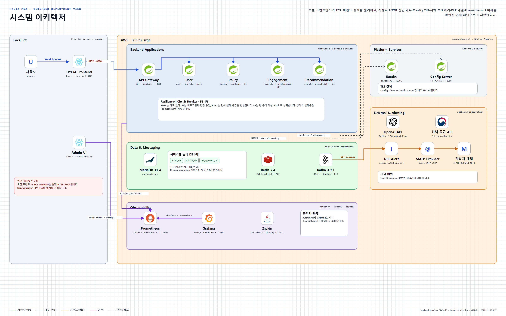
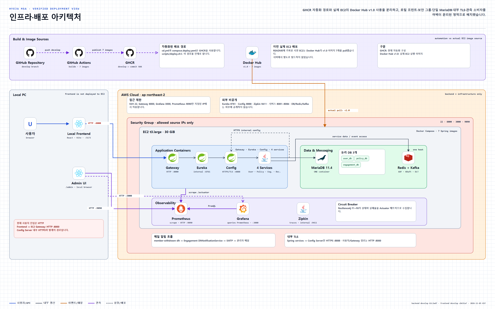

# 혜자 MSA (hyeja-msa)

청년 주거 정책 추천 서비스 「혜자」를 마이크로서비스 아키텍처로 전환한 LG CNS AM INSPIRE CAMP 6기 미니프로젝트 2 · 5조 저장소입니다. 하나였던 백엔드를 서비스 4개로 나누고, Gateway·Eureka·Config Server·Kafka로 연결해 AWS EC2 한 대에 Docker Compose로 배포했습니다.

          

- 혜자 코드: [hyeja-backend](https://github.com/LGCNS-AM06-Project2-TEAM5/hyeja-backend) (1차 백엔드, 서비스 분리의 출발점) · [hyeja-frontend](https://github.com/LGCNS-AM06-Project2-TEAM5/hyeja-frontend) (프런트엔드, 관리자 운영 화면 포함)
- 설정 저장소(Config Server용): [hyeja-config](https://github.com/LGCNS-AM06-Project2-TEAM5/hyeja-config)
- 기간: 2026-10-30(금) ~ 2026-11-05(목), 산출물 제출 11-05 오전 9시
- 설계 기준: [MSA 아키텍처 설계서](docs/architecture/HYEJA_MSA_Architecture_Design.md) · [설계서와 코드 대조 결과](docs/architecture/설계_코드_대조.md) · [서비스 간 계약](docs/api/README.md)
- 산출물 문서 목록: [docs/README.md](docs/README.md) · 요구사항별 구현 위치: [docs/02_요구사항명세서](docs/02_요구사항명세서/README.md)

## 아키텍처

두 그림 모두 develop 코드와 실제 시연 배포 기준입니다. 처음 설계 때 그린 구성도는 [docs/architecture](docs/architecture/README.md)에 설계 단계 자료로 남겨 두었습니다.

### 시스템 아키텍처



- 모든 사용자 요청은 Gateway(8000) 한 곳으로 들어오고, Gateway가 JWT를 검증한 뒤 서비스 4개로 보냅니다. 서비스는 Eureka에 이름으로 등록해 서로 찾고, 설정은 Config Server에서 HTTPS로 받습니다.
- 서비스 간 동기 호출은 OpenFeign F1~F6이고 모두 Resilience4j 서킷 브레이커를 거칩니다. 데이터 변경 전파는 Kafka 이벤트로 합니다.
- MariaDB 컨테이너 하나에 서비스별 논리 DB 3개를 두고, Redis는 로그아웃 블랙리스트·이메일 인증에 씁니다.
- Prometheus가 각 서비스의 Actuator 지표를 모으고 Grafana와 프런트 관리자 화면이 이를 조회합니다. Zipkin은 요청 하나가 서비스 사이를 지나는 경로를 기록합니다.

### 인프라 및 배포 아키텍처



- EC2(서울 리전 `ap-northeast-2`, t3.large, EBS 30GiB) 한 대에 백엔드 7개와 인프라 컨테이너를 Docker Compose로 띄웁니다. 프런트는 EC2에 올리지 않고 로컬 PC의 Vite 개발 서버에서 실행합니다.
- 보안 그룹은 허용한 IP에만 SSH 22, Gateway 8000, Grafana 3000, Prometheus 9090을 엽니다. 서비스 8081~8084, Eureka, Config, Zipkin, DB·Redis·Kafka는 밖에서 접근할 수 없습니다.
- 이미지 경로는 두 갈래입니다. GitHub Actions는 GHCR에 이미지를 자동으로 올리고, 실제 EC2 시연은 Docker Hub의 `v1.0` 이미지를 받아 실행했습니다(아래 [배포](#배포)).
- TLS는 Config Server 내부 통신에만 적용했습니다. 프런트에서 Gateway로 가는 사용자 요청은 HTTP입니다.

## 서비스 분리와 설계 근거

| 서비스 | 맡은 일 | 데이터 | Compose 포트 | 담당 |
|---|---|---|---|---|
| user-service | 회원가입·이메일 인증, 로그인·JWT 발급, 개인정보, 내 조건(프로필), 탈퇴, 관리자 계정 자동 생성 | `user_db` (지역은 읽기 복사본) | 8081 | 강태현, 차현준 |
| policy-service | 정책 원본·수집(온통청년), AI 정책 분석, 카드뉴스, 지역·용어, 정책 변경 이벤트 발행 | `policy_db` | 8082 | 김예준, 홍준서 |
| engagement-service | 관심 정책, 마감 D-7 앱 알림, 정책 스냅샷, 이벤트 구독(정책 변경·회원 탈퇴), DLT 관리자 메일 | `engagement_db` | 8083 | 이지원, 손수연 |
| recommendation-service | 자연어·해시태그 검색, AI 검색 의도 분석, 자격 판정, 3그룹 분류 | 없음 | 8084 | 류지범 |
| discovery · config · gateway | Eureka, Config Server, Spring Cloud Gateway | - | 8761 · 8888 · 8000 | 이지원 |

밖에서 들어오는 API 포트는 Gateway 8000 하나입니다. 서비스 포트는 Compose 안에서만 쓰고, 로컬 IDE 실행은 `server.port: 0`(빈 포트 자동 할당)입니다. AI는 별도 서비스로 두지 않고 정책 분석·카드뉴스는 Policy, 검색 의도 분석·판정 설명은 Recommendation에 두었습니다.

설계 결정:

1. **업무 책임과 데이터 소유권으로 나눴습니다.** 회원·인증 정보(User), 정책 원본(Policy), 회원이 정책에 남기는 관심·알림(Engagement), 검색 흐름(Recommendation)은 바뀌는 이유와 데이터 주인이 서로 다릅니다.
2. **다른 서비스의 DB를 직접 읽지 않습니다.** 서비스 사이 외래 키를 지우고 ID 값만 저장합니다. 필요한 정보는 Feign으로 묻거나 이벤트로 받은 복사본을 씁니다.
3. **MariaDB 컨테이너 1개에 논리 DB 3개**(`user_db`, `policy_db`, `engagement_db`)를 두었습니다. 계정도 DB마다 따로 만들어 자기 DB에만 권한이 있습니다. 시연 서버 한 대의 메모리 안에서 DB 분리를 지키기 위한 선택입니다.
4. **Recommendation은 DB가 없습니다.** 저장할 데이터가 없고, 회원 조건(F1)·정책 후보(F2)·관심 여부(F3)를 Feign으로 받아 판정만 합니다.
5. **User는 지역 데이터를 읽기 복사본으로 둡니다.** Policy와 같은 `region_sigungu.csv`를 기동 때 `user_db`에 적재해, 거주지 검증마다 Policy를 부르는 F7 호출을 만들지 않았습니다.
6. **자격 판정 규칙을 Policy와 Recommendation 양쪽에 같은 코드로 둡니다.** 정책 상세의 판정을 위해 Policy가 Recommendation을 부르면 Recommendation → Policy와 순환이 생기므로(F8), 판정 코드(`PolicyEligibilityEvaluator` 등)를 두 서비스에 각각 두고 같은 테스트로 맞춥니다. 별도 공유 모듈은 없습니다.
7. **회원 탈퇴와 정책 변경은 Kafka 이벤트로 최종 일관성을 맞춥니다.** 탈퇴 후 관심·알림 정리, 정책 변경 후 Engagement 스냅샷 갱신은 한 트랜잭션이 아니라 이벤트로 뒤따라 반영됩니다.

## 서비스 간 통신

### 동기 호출 (OpenFeign)

| 번호 | 호출 | 내용 | 실패할 때 |
|---|---|---|---|
| F1 | recommendation → user | 회원의 내 조건 조회 | 검색 실패(500 `SERVER_001`). `MEMBER_001`·`PROFILE_001`은 그대로 전달 |
| F2 | recommendation → policy | 정책 후보 일괄 조회 | 검색 실패(500 `SERVER_001`) |
| F3 | recommendation → engagement | 관심 여부 일괄 조회 | 하트 없이 응답 |
| F4 | policy → engagement | 관심 여부 일괄 조회 (목록·상세·카드뉴스) | 하트 없이 응답 |
| F5 | engagement → policy | 관심 등록 시 정책 존재·스냅샷 확인 | `404 POLICY_001`은 그대로, 그 밖의 장애는 503 `SERVER_002`. 관심을 저장하지 않고 기존 스냅샷으로 대신 등록하지도 않음 |
| F6 | policy → user | 회원의 내 조건 조회 (맞춤 목록·상세 판정·카드뉴스) | 비로그인 응답과 같게 |

F1~F6 모두 호출별 독립 Resilience4j 서킷 브레이커를 거칩니다. 최근 20회 중 10회 이상 호출되고 절반 이상 실패(5xx·연결 실패·시간 초과)하면 15초간 호출을 막고, 시험 호출 3회로 복구 여부를 정합니다. 4xx는 실패율에서 뺍니다. 회로가 열려 있어도 응답은 위 표와 같습니다. 내부 경로는 `/internal/**`이고 Gateway에 라우팅하지 않습니다. 요청·응답 형식은 [docs/api/README.md](docs/api/README.md)에 있습니다.

### 비동기 이벤트 (Kafka)

| 토픽 | 발행 → 구독 | 하는 일 |
|---|---|---|
| `policy-updated` | policy → engagement | 정책이 바뀌면 engagement의 정책 스냅샷을 고칩니다 |
| `member-withdrawn` | user → engagement | 회원이 탈퇴하면 관심 정책과 알림을 지웁니다 |
| `policy-updated-dlt` | engagement | 재시도 후에도 실패한 정책 이벤트를 보관합니다 |
| `member-withdrawn-dlt` | engagement | 재시도 후에도 실패한 탈퇴 이벤트를 보관하고 `failed_member_event`에 기록합니다 |
| `hyeja-config-bus` | Config Server → 전체 | Spring Cloud Bus 설정 일괄 갱신(업무 이벤트 아님) |

- **Outbox:** policy와 user는 데이터 변경과 같은 트랜잭션에 Outbox 행(`policy_outbox`, `member_outbox`)을 남기고, Relay가 커밋된 행을 Kafka로 보냅니다. 저장이 롤백되면 이벤트도 남지 않습니다.
- **중복 제거:** engagement는 처리한 `eventId`를 `processed_policy_event`·`processed_member_event`에 남기고, 같은 이벤트가 다시 오면 건너뜁니다. 처리 이력과 데이터 변경은 한 트랜잭션입니다.
- **재시도·DLT:** 처리에 실패하면 1초 간격으로 3번 더 시도하고, 그래도 실패하거나 JSON이 깨졌으면 DLT로 보냅니다.
- **DLT 관리자 메일:** `member-withdrawn-dlt` 메시지를 `failed_member_event`에 저장하고 토픽별 누적 건수를 셉니다. 누적이 임계값(`ADMIN_DLT_THRESHOLD`, 기본 3건)에 닿으면 `ADMIN_ALERT_EMAIL`로 메일을 보내고 누적을 0으로 되돌립니다. 발송에 실패하면 `ADMIN_DLT_RETRY_INTERVAL_MS`(기본 60초)마다 다시 보냅니다. SMTP 계정(`MAIL_*`)과 수신 주소는 환경변수로 넣습니다.

`member-registered`(웰컴 메일)·`notification-created`(마감 알림 메일) 토픽은 `kafka-init`이 만들기만 하고, 발행·구독하는 코드는 없습니다.

### 인증과 내부 보안

- **Gateway:** 사용자 JWT(HS256, `JWT_SECRET`)의 서명·만료를 확인하고 Redis 로그아웃 블랙리스트를 조회합니다. 밖에서 보낸 `X-Member-Id`·`X-Member-Role`은 지우고 검증한 값으로 다시 붙입니다. user·policy·recommendation은 이 헤더를 믿고, 서비스 포트를 외부에 열지 않는 것을 전제로 합니다.
- **Engagement:** Gateway가 따로 발급한 내부 JWT(`X-Gateway-Assertion`, 수명 2분)를 검증합니다. 이 키(`GATEWAY_ENGAGEMENT_SECRET`)는 사용자 JWT 키와 다른 값입니다. `X-Member-Id`만 보낸 요청은 인증되지 않습니다. [상세 계약](docs/architecture/gateway-engagement-auth.md)
- **서비스 간 Feign 호출:** 별도 서비스 인증 토큰 없이 Compose 내부 네트워크에서만 호출합니다. 외부 차단은 Gateway가 `/internal/**`을 라우팅하지 않는 것과 서비스 포트를 열지 않는 것으로 합니다.
- **Config Server:** HTTPS만 제공하고, 서비스마다 다른 Basic 계정으로 자기 설정만 조회할 수 있습니다. Git의 `{cipher}` 값은 Config Server만 가진 키로 복호화합니다.

## 적용한 기술

| 구분 | 내용 | 자세한 문서 |
|---|---|---|
| 진입점·인증 | Spring Cloud Gateway, JWT 검증, Redis 블랙리스트, CORS, 라우팅 | [gateway-service](infra/gateway-service/README.md) |
| 서비스 등록·탐색 | Eureka | [discovery-service](infra/discovery-service/README.md) |
| 설정 관리 | Config Server(HTTPS, 서비스별 계정), 설정 암호화, Cloud Bus 일괄 갱신 | [config-service](infra/config-service/README.md) |
| 서비스 간 통신 | OpenFeign(F1~F6), Kafka 이벤트(Outbox·중복 제거·DLT) | [api](docs/api/README.md) |
| 장애 대응 | Resilience4j 서킷 브레이커(F1~F6), DLT 보관과 관리자 메일 | 서비스별 README |
| 모니터링 | Actuator·Micrometer 지표 → Prometheus → Grafana 대시보드, Zipkin 분산 추적, 프런트 관리자 운영 화면 | [docker](docker/README.md) |
| 컨테이너 | 서비스별 Dockerfile, Docker Compose 통합 실행, 서비스별 메모리 상한 | [docker](docker/README.md) |
| CI/CD | PR마다 바뀐 서비스만 테스트·빌드(`ci.yml`), develop에 합쳐지면 서비스 이미지 7개를 GHCR에 올림(`cd.yml`) | [.github/workflows](.github/workflows) |
| 배포 | AWS EC2 한 대에 Docker Compose로 전체 실행 | 아래 [배포](#배포) |

## 모니터링과 운영

- **지표:** Gateway와 업무 서비스 4개가 Actuator·Micrometer로 `/actuator/prometheus`를 열고(모니터링 전용 Basic 계정), Prometheus가 7일간 보관합니다. HTTP 요청 수·p95·5xx 비율, OpenFeign 호출 수, 서킷 브레이커 상태(`resilience4j_circuitbreaker_*`), JVM·DB 커넥션을 봅니다. 회로 상태가 바뀌면 WARN 로그도 남깁니다.
- **Kafka 처리 지표:** engagement가 `hyeja_policy_updated_events_total{result="applied"|"duplicate"}`(반영·중복 무시)와 `hyeja_policy_updated_dlt_total`(DLT로 보낸 수)을 셉니다. 서비스 시작 이후 누적값입니다.
- **Grafana:** Prometheus 데이터 소스와 "혜자 MSA 운영 현황" 대시보드가 provisioning으로 자동 등록됩니다. 로그인 화면과 Basic 인증을 끈 익명 Viewer 전용이고, 로컬은 `127.0.0.1`, EC2는 보안 그룹이 허용한 IP에만 열려 있습니다.
- **Zipkin:** 7개 애플리케이션이 100% 샘플링으로 trace를 보냅니다. 메모리 저장소라 재시작하면 사라집니다.
- **관리자 API:** `GET /api/policies/admin/events`(ADMIN 전용)는 `policy-updated` Outbox의 미발행·발행 건수, 마지막 발행 시각, 최근 10건을 돌려줍니다.
- **관리자 계정 자동 생성:** user-service가 기동할 때 `ADMIN_EMAIL`·`ADMIN_PASSWORD`가 있고 같은 이메일이 없으면 관리자 계정을 한 번 만듭니다(비밀번호는 BCrypt). 값이 비어 있으면 건너뜁니다.
- **프런트 관리자 화면:** [hyeja-frontend](https://github.com/LGCNS-AM06-Project2-TEAM5/hyeja-frontend)의 관리자 운영 화면에서 서비스 상태, 요청·응답 시간·오류율, 서킷 브레이커, 이벤트 발행 현황을 봅니다.

## 저장소 구조

```text
hyeja-msa/
├── infra/
│   ├── discovery-service/   Eureka 서버
│   ├── gateway-service/     Spring Cloud Gateway (단일 진입점, JWT 검증, CORS, 라우팅)
│   └── config-service/      Spring Cloud Config Server (hyeja-config 저장소를 읽음)
├── services/
│   ├── user-service/            회원·내 조건, 로그인·JWT, 이메일 인증, 탈퇴 이벤트 발행
│   ├── policy-service/          정책 조회·수집, 지역, 용어, AI 정책 분석·카드뉴스, 정책 변경 이벤트 발행
│   ├── engagement-service/      관심 정책, 마감 D-7 알림, 정책 스냅샷, 이벤트 구독, DLT 관리자 메일
│   └── recommendation-service/  맞춤 검색, 자격 판정, AI 의도 분석·판정 설명
├── docker/                  MariaDB 초기화, Prometheus·Grafana 설정, Config TLS 인증서·점검 스크립트
├── scripts/deploy.sh        GHCR 이미지로 전체 실행 후 헬스 체크
├── compose.yaml             전체 통합 실행 (소스에서 빌드)
├── compose.deploy.yaml      빌드 대신 GHCR 이미지를 쓰는 덮어쓰기 파일
├── compose.bus-test.yaml    Cloud Bus 설정 갱신 확인용 덮어쓰기 파일
├── k8s/                     (선택 요구사항) 이번 범위에서 하지 않음, 매니페스트 없음
└── docs/                    산출물, 아키텍처, 서비스 간 계약, 테스트 기록
```

## 실행 방법

필요한 것: Docker와 Compose v2, Docker 메모리 8GB 이상(JVM 7개와 MariaDB·Kafka·Redis·Prometheus·Grafana·Zipkin을 함께 띄웁니다. 컨테이너 메모리 상한 합계는 약 6.1GB), Config 인증서를 만들 PowerShell과 Java 17 `keytool`.

```powershell
# 1. 환경변수: 처음 한 번 복사하고 비밀값은 팀 채널에서 받아 채웁니다 (기존 .env는 덮어쓰지 않음)
Copy-Item .env.example .env
# 2. Config Server TLS 인증서: .env의 CONFIG_TLS_KEY_STORE_PASSWORD·CONFIG_TLS_TRUST_STORE_PASSWORD와 같은 값을 입력
powershell -ExecutionPolicy Bypass -File docker/New-ConfigTls.ps1
# 3. 설정 확인 후 전체 실행
docker compose config --quiet
docker compose up -d --build --wait --wait-timeout 600
docker compose ps
# 4. Gateway 헬스 체크, 서비스 4개까지 확인하려면 점검 스크립트
curl.exe http://localhost:8000/actuator/health
powershell -File docker/Test-Compose.ps1
```

`.env`에 반드시 채울 값은 DB 비밀번호(`DB_ROOT_PASSWORD`, `USER_DB_PASSWORD`, `POLICY_DB_PASSWORD`, `ENGAGEMENT_DB_PASSWORD`), `JWT_SECRET`, `GATEWAY_ENGAGEMENT_SECRET`, `CONFIG_ENCRYPT_KEY`, Config 계정 비밀번호 6개, TLS 저장소 비밀번호 2개, `MONITORING_PASSWORD`입니다. 값이 빠지면 `docker compose config`가 어떤 변수가 없는지 알려 줍니다. AI·온통청년 키, 메일, 관리자 계정 값과 변수별 조건은 [docker/README.md](docker/README.md)에 있습니다.

소스를 빌드하지 않고 GHCR에 올라간 이미지로 띄우려면 `./scripts/deploy.sh`를 실행합니다(`compose.yaml` 위에 `compose.deploy.yaml`을 덮어씀, GHCR 로그인 필요).

| 주소 | 내용 |
|---|---|
| http://localhost:8000 | Gateway (프런트가 부르는 API) |
| http://localhost:8761 | Eureka 대시보드 |
| http://localhost:3000 | Grafana (로그인 없이 보기 전용) |
| http://localhost:9090 | Prometheus |
| http://localhost:9411 | Zipkin |

프런트는 [hyeja-frontend](https://github.com/LGCNS-AM06-Project2-TEAM5/hyeja-frontend)에서 실행합니다. 프런트 `.env`에 `VITE_API_BASE_URL=http://localhost:8000`(EC2에 붙일 때는 서버 주소의 8000), `VITE_USE_MOCK=false`를 넣고 `npm run dev`로 띄우면 http://localhost:5173 에서 열립니다. Gateway CORS는 이 주소만 허용합니다.

## 배포

GHCR 자동 발행과 실제 EC2 배포는 별개의 경로입니다. GitHub Actions는 EC2에 자동으로 배포하지 않습니다.

**GitHub Actions + GHCR (자동화된 이미지 경로)**

- `ci.yml`: PR에서는 바뀐 서비스(`services/*`, `infra/*`)만, develop·main push에서는 전체 서비스를 Java 17로 `test bootJar`합니다.
- `cd.yml`: develop push마다 애플리케이션 이미지 7개를 linux/amd64로 빌드해 GHCR에 `develop`과 커밋 SHA 태그로 올립니다.
- `compose.deploy.yaml` + `scripts/deploy.sh`: 이 이미지를 받아(pull) 전체를 띄우고 Gateway로 서비스 4개 헬스 체크를 합니다. `IMAGE_TAG=<커밋 SHA>`로 특정 버전을 실행할 수 있습니다.

**실제 AWS EC2 시연 배포**

- AWS 서울 리전(`ap-northeast-2`) EC2 t3.large, EBS 30GiB 한 대에 이 저장소를 받아 Docker Compose로 백엔드와 인프라 전체를 띄웠습니다.
- 이미지는 Docker Hub에 올린 `v1.0` 이미지 7개를 받아 씁니다. 서버에서는 빌드하지 않습니다.
- 기본 `compose.yaml`은 포트를 `127.0.0.1`에만 열어 두므로, 서버에서는 Gateway 8000·Grafana 3000·Prometheus 9090만 밖으로 여는 덮어쓰기 파일을 함께 씁니다.
- 보안 그룹은 SSH 22와 위 3개 포트만 열고, 접속할 IP만 허용합니다. 서버 주소는 팀 채널에서 공유합니다.
- `.env`와 Config TLS 인증서는 저장소에 넣지 않고 서버에 따로 옮깁니다. 프런트는 로컬 PC에서 실행해 EC2의 Gateway를 HTTP로 부릅니다.

## 통합 검증 결과

검증마다 실행 환경과 범위가 다르므로 수치를 합산하지 않습니다. 자세한 항목은 [docs/05_테스트케이스](docs/05_테스트케이스/README.md)에 있습니다.

| 검증 | 환경 | 결과 |
|---|---|---|
| [Policy 최종 통합](docs/05_테스트케이스/policy-final-integration-119.md) (PR #123) | 로컬 개별 JVM 6개 + 실제 Gateway·프런트·OpenAI·Kafka. Compose·Config TLS 제외 | API 24항목, Kafka 5항목(Outbox → 스냅샷, 중복 무시, 깨진 JSON·저장 실패 → DLT), 화면 9시나리오 통과 |
| [User 실제 환경](docs/05_테스트케이스/user-live-verification-127.md) (PR #128) | GHCR 이미지 + `deploy.sh`로 Compose 전체 실행(로컬) | 21항목 통과: 가입·메일 인증·로그인·내 조건, 헤더 위조 차단, 탈퇴 → Outbox → Kafka → engagement 정리, Zipkin에서 F1·F2·F6 trace. 정책 0건이라 F1·F6 결과 내용은 미검증 |
| [F2 실제 연동](docs/05_테스트케이스/f2-live-verification-77.md) (PR #114) | 로컬 JVM, 실제 F1·F2·F3, OpenAI만 대체 | 45항목 통과 |
| [F5 실제 연동](docs/05_테스트케이스/f5-live-verification-112.md) (PR #113) | 로컬 JVM, 실제 Eureka·Policy·Engagement·MariaDB | 35항목 통과 |
| 메모리·반복 시연 (PR #130) | 로컬 Compose, 시연 흐름(가입~탈퇴) 5회 반복 | 모두 200, OOM 없음. 상한 조정 후 11개 healthy. 부하 테스트는 아님 |
| 관측성 (PR #111, #129) | 로컬 Compose | Prometheus에서 Kafka 카운터(반영·중복·DLT 각 1) 확인, Grafana 패널 10개 쿼리 값 확인 |

자동 테스트는 CI가 서비스별로 돌립니다. 회원 탈퇴 이벤트 멱등성(PR #110), DLT 관리자 메일 임계값(PR #107), F5 서킷 브레이커(PR #122)는 자동 테스트로 확인했고 Compose 실측은 하지 않았습니다. EC2 시연 배포의 검증 기록은 이 저장소에 없습니다.

## 구현 범위와 제한 사항

- Kubernetes 실제 배포, Saga 보상 트랜잭션은 이번 범위에서 하지 않았습니다. 탈퇴는 이벤트 + 재시도·DLT로 처리합니다.
- k6 같은 도구로 한 정식 부하 테스트는 하지 않았습니다(시연 흐름 반복으로 메모리만 확인).
- 웰컴 메일(`member-registered`)과 마감 알림 이메일 Worker(`notification-created`)는 구현하지 않았습니다. 마감 D-7 알림은 앱 알림만 만듭니다. 회원가입 이메일 인증 메일과 DLT 관리자 장애 알림 메일은 구현되어 있습니다.
- 사용자 진입 경로(프런트 → Gateway)는 HTTPS가 아니라 HTTP입니다. TLS는 Config Server 통신에만 있습니다.
- 서비스 간 Feign 호출에는 별도 서비스 인증이 없고 네트워크 격리에 기댑니다. Kafka는 단일 노드·복제본 1개, Zipkin은 메모리 저장소입니다.

## 협업 규칙

자세한 내용은 [docs/협업규칙.md](docs/협업규칙.md)에 있습니다.

- `main`: 발표·제출용. `develop`에서만 PR로 합칩니다.
- `develop`: 기본 브랜치. 모든 작업 브랜치는 여기서 만들고 여기로 PR을 보냅니다.
- 작업 브랜치: `<tag>/<이슈번호>/<영문-설명>` (예: `feat/12/user-service-split`)
- 커밋: `<tag> : <변경 내용>` (예: `feat : user-service Eureka 등록`)
- 라벨: 작업 종류(`feat` 등) 1개 + 영역(`user`·`policy`·`engagement`·`recommendation`·`infra` 등) 1개 이상
- 서비스 폴더마다 담당자가 [CODEOWNERS](.github/CODEOWNERS)로 지정되어 PR에 자동으로 리뷰어로 들어갑니다.
- 비밀값(`.env`, API 키, 비밀번호, 인증서)은 커밋하지 않습니다.

## 팀 (5조)

| 이름 | GitHub | 맡은 일 |
|---|---|---|
| 이지원 | [@ljw2869](https://github.com/ljw2869) | Infra(Eureka·Config·Gateway·Docker Compose), Engagement(관심·알림, 탈퇴 이벤트 구독) |
| 김예준 | [@yejun05011](https://github.com/yejun05011) | Policy(정책 수집·조회, AI 분석, F2·F5 제공) |
| 홍준서 | [@jnnxeo](https://github.com/jnnxeo) | Policy(지역·용어·카드뉴스·F4·F6), 정책 변경 이벤트, CI, 관리자 운영 화면 |
| 류지범 | [@JibeomRyu](https://github.com/JibeomRyu) | Recommendation(맞춤 검색·판정, 서킷 브레이커) |
| 강태현 | [@kangtaee](https://github.com/kangtaee) | User, CD |
| 차현준 | [@deallight](https://github.com/deallight) | User, CD |
| 손수연 | [@hand-soo](https://github.com/hand-soo) | Engagement(F3 관심 여부 조회) |
