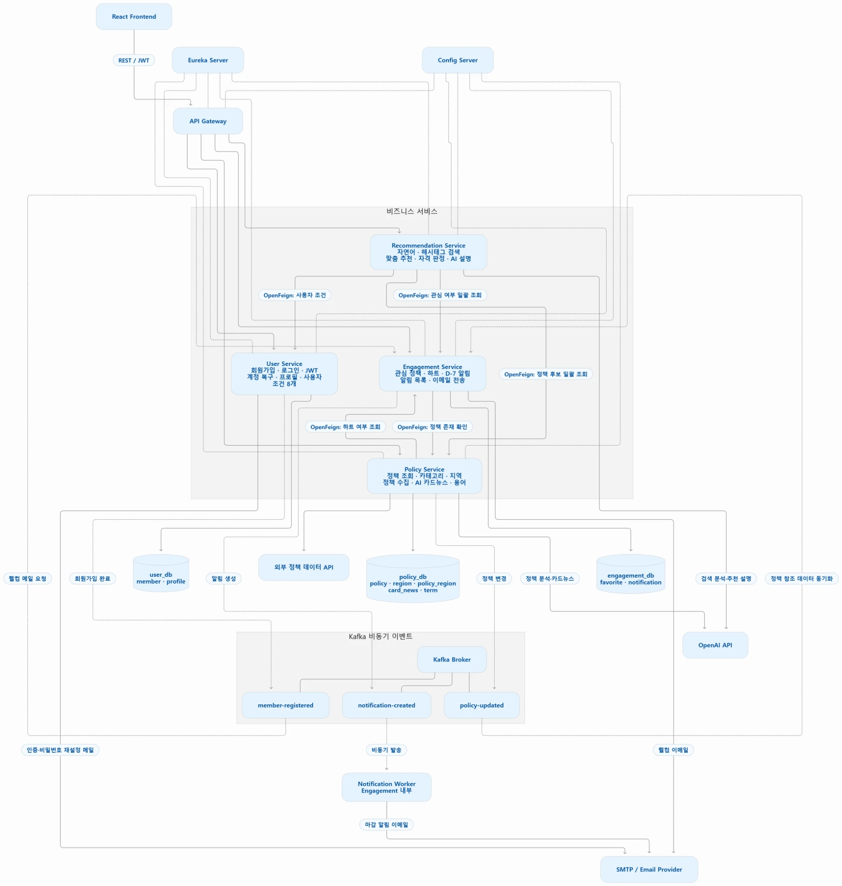

# 혜자 MSA (hyeja-msa)

청년 주거 정책 추천 서비스 「혜자」를 마이크로서비스 아키텍처로 전환하는 LG CNS AM INSPIRE CAMP 6기 미니프로젝트 2 · 5조 저장소입니다.

- 혜자 코드: [hyeja-backend](https://github.com/LGCNS-AM06-Project2-TEAM5/hyeja-backend) (백엔드, 서비스 분리의 출발점) · [hyeja-frontend](https://github.com/LGCNS-AM06-Project2-TEAM5/hyeja-frontend) (프런트엔드)
- 설정 저장소(Config Server용): [hyeja-config](https://github.com/LGCNS-AM06-Project2-TEAM5/hyeja-config)
- 기간: 2026-10-30(금) ~ 2026-11-05(목), 산출물 제출 11-05 오전 9시
- 설계 기준: [MSA 아키텍처 설계서](docs/architecture/HYEJA_MSA_Architecture_Design.md) · [설계서와 코드 대조 결과](docs/architecture/설계_코드_대조.md) · [서비스 간 계약](docs/api/README.md)

## 아키텍처



- 서비스 4개: User, Policy, Engagement, Recommendation. AI는 별도 서비스로 두지 않고 정책 분석·카드뉴스는 Policy, 검색·판정 설명은 Recommendation에 둡니다.
- DB 3개: `user_db`, `policy_db`, `engagement_db`. Recommendation은 DB 없이 다른 서비스를 Feign으로 조회합니다.
- 동기 통신은 OpenFeign, 비동기 통신은 Kafka(`member-registered`, `policy-updated`, `notification-created`).

## 저장소 구조

```text
hyeja-msa/
├── infra/
│   ├── discovery-service/   Eureka 서버
│   ├── gateway-service/     Spring Cloud Gateway (단일 진입점, JWT 검증, CORS, 라우팅)
│   └── config-service/      Spring Cloud Config Server (hyeja-config 저장소를 읽음)
├── services/
│   ├── user-service/            회원·내 조건, 로그인·JWT, 이메일 인증, 탈퇴
│   ├── policy-service/          정책 조회·수집, 지역, 용어, AI 정책 분석·카드뉴스
│   ├── engagement-service/      관심 정책, D-7 알림, (승인 시) 메일 발송
│   └── recommendation-service/  맞춤 검색, 자격 판정, AI 의도 분석·판정 설명
├── docker/                  Docker Compose 통합 실행
├── k8s/                     (선택) Kubernetes 매니페스트
└── docs/                    산출물, 아키텍처, 서비스 간 계약, 회의록
```

## 서비스·담당·포트

| 서비스 | 담당 | 포트 | DB |
|---|---|---|---|
| discovery-service · config-service · gateway-service | 이지원 | 8761 · 8888 · 8000 | - |
| user-service | 강태현, 차현준 | 8081 | user_db |
| policy-service | 김예준, 홍준서 | 8082 | policy_db |
| engagement-service | 손수연 | 8083 | engagement_db |
| recommendation-service | 류지범 | 8084 | - |

## 협업 규칙

자세한 내용은 [docs/협업규칙.md](docs/협업규칙.md)에 있습니다.

- `main`: 발표·제출용. `develop`에서만 PR로 합칩니다.
- `develop`: 기본 브랜치. 모든 작업 브랜치는 여기서 만들고 여기로 PR을 보냅니다.
- 작업 브랜치: `<tag>/<이슈번호>/<영문-설명>` (예: `feat/12/user-service-split`)
- 커밋: `<tag> : <변경 내용>` (예: `feat : user-service Eureka 등록`)
- 라벨: 작업 종류(`feat` 등) 1개 + 영역(`user`·`policy`·`engagement`·`recommendation`·`infra` 등) 1개 이상
- 서비스 폴더마다 담당자가 [CODEOWNERS](.github/CODEOWNERS)로 지정되어 PR에 자동으로 리뷰어로 들어갑니다.
- 비밀값(`.env`, API 키, 비밀번호)은 커밋하지 않습니다.

## 실행 방법

서비스 골격이 만들어지면 채웁니다. 목표는 `docker compose up` 한 번으로 전체가 뜨는 것입니다.

서비스 코드는 [hyeja-backend](https://github.com/LGCNS-AM06-Project2-TEAM5/hyeja-backend)에서 필요한 부분을 가져와 `services/` 아래로 옮깁니다. 서비스별로 옮길 코드는 각 서비스 README에 적어 두었습니다.

프런트는 [hyeja-frontend](https://github.com/LGCNS-AM06-Project2-TEAM5/hyeja-frontend)에서 작업합니다. 로컬 `.env`에 `VITE_API_BASE_URL=http://localhost:8000`, `VITE_USE_MOCK=false`를 넣고 실행합니다.

## 팀 (5조)

| 이름 | GitHub | 담당 |
|---|---|---|
| 이지원 | [@ljw2869](https://github.com/ljw2869) | Infra (Eureka·Config·Gateway·Docker·K8s) |
| 김예준 | [@yejun05011](https://github.com/yejun05011) | Policy |
| 홍준서 | [@jnnxeo](https://github.com/jnnxeo) | Policy |
| 류지범 | [@JibeomRyu](https://github.com/JibeomRyu) | Recommendation |
| 강태현 | [@kangtaee](https://github.com/kangtaee) | User |
| 차현준 | | User |
| 손수연 | [@hand-soo](https://github.com/hand-soo) | Engagement |
