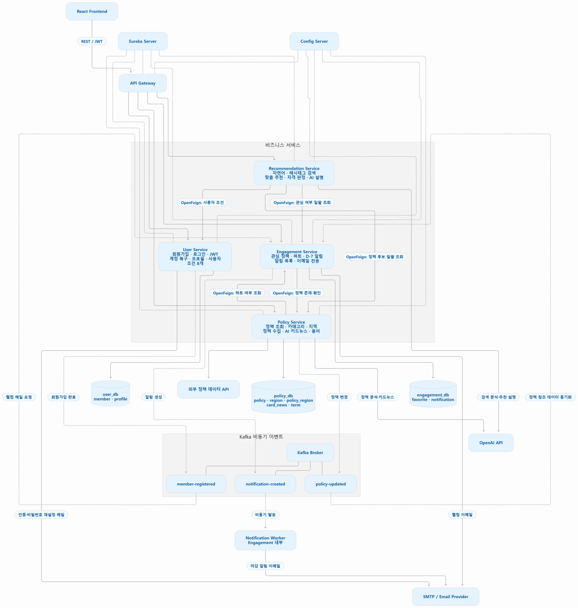

# 혜자 MSA (hyeja-msa)

청년 주거 정책 추천 서비스 「혜자」를 마이크로서비스 아키텍처로 전환한 LG CNS AM INSPIRE CAMP 6기 미니프로젝트 2 · 5조 저장소입니다.

- 혜자 코드: [hyeja-backend](https://github.com/LGCNS-AM06-Project2-TEAM5/hyeja-backend) (1차 백엔드, 서비스 분리의 출발점) · [hyeja-frontend](https://github.com/LGCNS-AM06-Project2-TEAM5/hyeja-frontend) (프런트엔드, 관리자 운영 화면 포함)
- 설정 저장소(Config Server용): [hyeja-config](https://github.com/LGCNS-AM06-Project2-TEAM5/hyeja-config)
- 기간: 2026-10-30(금) ~ 2026-11-05(목), 산출물 제출 11-05 오전 9시
- 설계 기준: [MSA 아키텍처 설계서](docs/architecture/HYEJA_MSA_Architecture_Design.md) · [설계서와 코드 대조 결과](docs/architecture/설계_코드_대조.md) · [서비스 간 계약](docs/api/README.md)
- 산출물 문서 목록: [docs/README.md](docs/README.md)

## 아키텍처



- 서비스 4개: User, Policy, Engagement, Recommendation. AI는 별도 서비스로 두지 않고 정책 분석·카드뉴스는 Policy, 검색 의도 분석·판정 설명은 Recommendation에 둡니다.
- DB 3개: `user_db`, `policy_db`, `engagement_db`. Recommendation은 DB 없이 다른 서비스를 Feign으로 조회합니다.
- 모든 요청은 Gateway(8000) 한 곳으로 들어옵니다. Gateway가 JWT를 검증한 뒤 `X-Member-Id`·`X-Member-Role` 헤더를 다시 붙여 서비스로 넘기고, 밖에서 보낸 같은 이름의 헤더는 지웁니다.
- 서비스는 Eureka에 이름으로 등록하고 서로 이름으로 찾습니다. 설정은 Config Server가 hyeja-config 저장소에서 읽어 주고, Cloud Bus(Kafka `hyeja-config-bus`)로 한 번에 다시 읽힙니다.

### 서비스 간 동기 호출 (OpenFeign)

| 번호 | 호출 | 내용 | 실패할 때 |
|---|---|---|---|
| F1 | recommendation → user | 회원의 내 조건 조회 | 검색 실패 응답 |
| F2 | recommendation → policy | 정책 후보 일괄 조회 | 검색 실패 응답 |
| F3 | recommendation → engagement | 관심 여부 일괄 조회 | 하트 없이 응답 |
| F4 | policy → engagement | 관심 여부 일괄 조회 (목록·상세·카드뉴스) | 하트 없이 응답 |
| F5 | engagement → policy | 관심 등록 시 정책 존재·스냅샷 확인 | 등록 실패 안내 |
| F6 | policy → user | 회원의 내 조건 조회 (맞춤 목록·상세 판정·카드뉴스) | 비로그인 응답과 같게 |

모든 호출에 Resilience4j 서킷 브레이커와 대체 응답을 붙였습니다. 요청·응답 형식은 [docs/api/README.md](docs/api/README.md)에 있습니다.

### 서비스 간 비동기 이벤트 (Kafka)

| 토픽 | 발행 → 구독 | 하는 일 |
|---|---|---|
| `policy-updated` | policy → engagement | 정책이 바뀌면 engagement의 정책 스냅샷을 고칩니다 |
| `member-withdrawn` | user → engagement | 회원이 탈퇴하면 관심 정책과 알림을 지웁니다 |
| `policy-updated-dlt` · `member-withdrawn-dlt` | engagement | 재시도 후에도 실패한 메시지를 모아 둡니다 |

발행은 같은 트랜잭션에 Outbox 행을 남긴 뒤 Kafka로 보내고, 구독은 `eventId`로 중복을 걸러 냅니다. `member-registered`·`notification-created` 토픽은 만들어만 두었고 이번 범위에서는 쓰지 않습니다.

## 적용한 기술

| 구분 | 내용 | 자세한 문서 |
|---|---|---|
| 진입점·인증 | Spring Cloud Gateway, JWT 검증, CORS, 라우팅 | [gateway-service](infra/gateway-service/README.md) |
| 서비스 등록·탐색 | Eureka | [discovery-service](infra/discovery-service/README.md) |
| 설정 관리 | Config Server(HTTPS, 서비스별 계정), 설정 암호화, Cloud Bus 일괄 갱신 | [config-service](infra/config-service/README.md) |
| 서비스 간 통신 | OpenFeign(F1~F6), Kafka 이벤트(Outbox·중복 제거·DLT) | [api](docs/api/README.md) |
| 장애 대응 | Resilience4j 서킷 브레이커와 대체 응답 | 서비스별 README |
| 모니터링 | Actuator·Micrometer 지표 → Prometheus → Grafana 대시보드, Zipkin 분산 추적, 프런트 관리자 운영 화면 | [docker](docker/README.md) |
| 컨테이너 | 서비스별 Dockerfile, Docker Compose 통합 실행 | [docker](docker/README.md) |
| CI/CD | PR마다 바뀐 서비스만 테스트·빌드(`ci.yml`), develop에 합쳐지면 서비스 이미지 7개를 GHCR에 올림(`cd.yml`), `scripts/deploy.sh`로 받아서 실행 | [.github/workflows](.github/workflows) |
| 배포 | AWS EC2 한 대에 Docker Compose로 전체 실행 | 아래 "배포" |

## 저장소 구조

```text
hyeja-msa/
├── infra/
│   ├── discovery-service/   Eureka 서버
│   ├── gateway-service/     Spring Cloud Gateway (단일 진입점, JWT 검증, CORS, 라우팅)
│   └── config-service/      Spring Cloud Config Server (hyeja-config 저장소를 읽음)
├── services/
│   ├── user-service/            회원·내 조건, 로그인·JWT, 이메일 인증, 탈퇴 이벤트 발행
│   ├── policy-service/          정책 조회·수집, 지역, 용어, AI 정책 분석·카드뉴스, 정책 변경 이벤트 발행
│   ├── engagement-service/      관심 정책, 마감 D-7 알림, 정책 스냅샷, 이벤트 구독
│   └── recommendation-service/  맞춤 검색, 자격 판정, AI 의도 분석·판정 설명
├── docker/                  MariaDB 초기화, Prometheus·Grafana 설정, Config TLS 인증서 스크립트
├── scripts/deploy.sh        GHCR 이미지로 전체 실행 후 헬스 체크
├── compose.yaml             전체 통합 실행
├── compose.deploy.yaml      빌드 대신 GHCR 이미지를 쓰는 덮어쓰기 파일
├── k8s/                     (선택 요구사항) 아직 매니페스트 없음
└── docs/                    산출물, 아키텍처, 서비스 간 계약, 테스트 기록
```

## 서비스·담당·포트

밖에서 들어오는 포트는 Gateway 8000 하나입니다. 서비스 포트는 Compose 안에서만 쓰고, 로컬 IDE 실행은 `server.port: 0`(빈 포트 자동 할당)입니다.

| 서비스 | 담당 | Compose 포트 | DB |
|---|---|---|---|
| discovery · config · gateway | 이지원 | 8761 · 8888 · 8000 | - |
| user-service | 강태현, 차현준 | 8081 | user_db (지역은 읽기 복사본) |
| policy-service | 김예준, 홍준서 | 8082 | policy_db |
| engagement-service | 이지원, 손수연 | 8083 | engagement_db |
| recommendation-service | 류지범 | 8084 | - |

## 실행 방법

필요한 것: Docker와 Compose v2, Docker 메모리 8GB 이상(JVM 7개와 MariaDB·Kafka·Redis·Prometheus·Grafana·Zipkin을 함께 띄웁니다). 각 서비스에 메모리 상한을 걸어 두어 합계가 약 6GB입니다.

```bash
cp .env.example .env               # 처음 한 번. 비밀값은 팀 채널에서 받아 채웁니다
docker compose up -d --build --wait --wait-timeout 600
docker compose ps
```

이미 올라간 이미지로 빌드 없이 띄우려면 `./scripts/deploy.sh`를 실행합니다(GHCR 로그인 필요). 환경변수, Config TLS 인증서 만들기, 점검 스크립트는 [docker/README.md](docker/README.md)에 있습니다.

| 주소 | 내용 |
|---|---|
| http://localhost:8000 | Gateway (프런트가 부르는 API) |
| http://localhost:8761 | Eureka 대시보드 |
| http://localhost:3000 | Grafana (로그인 없이 보기 전용) |
| http://localhost:9090 | Prometheus |
| http://localhost:9411 | Zipkin |

프런트는 [hyeja-frontend](https://github.com/LGCNS-AM06-Project2-TEAM5/hyeja-frontend)에서 실행합니다. 프런트 `.env`에 `VITE_API_BASE_URL=http://localhost:8000`, `VITE_USE_MOCK=false`를 넣고 `npm run dev`로 띄우면 http://localhost:5173 에서 열립니다. Gateway CORS는 이 주소만 허용합니다.

## 배포

AWS EC2(서울 리전, t3.large, 디스크 30GiB) 한 대에 이 저장소를 받아 Docker Compose로 전체를 띄웠습니다.

- 이미지는 Docker Hub에 올린 `v1.0` 이미지 7개를 받아 씁니다. 빌드는 서버에서 하지 않습니다.
- 기본 `compose.yaml`은 포트를 `127.0.0.1`에만 열어 두므로, 서버에서는 Gateway 8000·Grafana 3000·Prometheus 9090만 밖으로 여는 덮어쓰기 파일을 함께 씁니다.
- 보안 그룹은 SSH 22와 위 3개 포트만 열고, 접속할 IP만 허용합니다. 서버 주소는 팀 채널에서 공유합니다.
- `.env`와 Config TLS 인증서는 저장소에 넣지 않고 서버에 따로 옮깁니다.

## 협업 규칙

자세한 내용은 [docs/협업규칙.md](docs/협업규칙.md)에 있습니다.

- `main`: 발표·제출용. `develop`에서만 PR로 합칩니다.
- `develop`: 기본 브랜치. 모든 작업 브랜치는 여기서 만들고 여기로 PR을 보냅니다.
- 작업 브랜치: `<tag>/<이슈번호>/<영문-설명>` (예: `feat/12/user-service-split`)
- 커밋: `<tag> : <변경 내용>` (예: `feat : user-service Eureka 등록`)
- 라벨: 작업 종류(`feat` 등) 1개 + 영역(`user`·`policy`·`engagement`·`recommendation`·`infra` 등) 1개 이상
- 서비스 폴더마다 담당자가 [CODEOWNERS](.github/CODEOWNERS)로 지정되어 PR에 자동으로 리뷰어로 들어갑니다.
- 비밀값(`.env`, API 키, 비밀번호, 인증서)은 커밋하지 않습니다.

## 팀 (5조)

| 이름 | GitHub | 맡은 일 |
|---|---|---|
| 이지원 | [@ljw2869](https://github.com/ljw2869) | Infra(Eureka·Config·Gateway·Docker Compose), Engagement(관심·알림, 탈퇴 이벤트 구독) |
| 김예준 | [@yejun05011](https://github.com/yejun05011) | Policy(정책 수집·조회, AI 분석, F2·F5 제공) |
| 홍준서 | [@jnnxeo](https://github.com/jnnxeo) | Policy(지역·용어·카드뉴스·F4·F6), 정책 변경 이벤트, CI, 관리자 운영 화면 |
| 류지범 | [@JibeomRyu](https://github.com/JibeomRyu) | Recommendation(맞춤 검색·판정, 서킷 브레이커) |
| 강태현 | [@kangtaee](https://github.com/kangtaee) | User, CD |
| 차현준 | [@deallight](https://github.com/deallight) | User, CD |
| 손수연 | [@hand-soo](https://github.com/hand-soo) | Engagement(F3 관심 여부 조회) |
