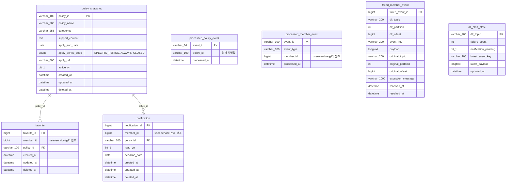

# engagement_db ERD

## 범위

`engagement-service`가 소유하는 JPA 엔티티를 기준으로 작성한 논리·물리 ERD입니다.

- `policy_snapshot`은 policy-service 원본 정책의 로컬 읽기 모델입니다.
- `favorite`, `notification`의 `policy_id`만 같은 DB의 `policy_snapshot`을 참조하는 물리 FK입니다.
- `member_id`는 user-service가 소유한 회원 식별자의 논리 참조이며, 서비스 간 DB 결합을 피하기 위해 물리 FK를 두지 않습니다.
- 이벤트 처리 및 DLT 운영 테이블은 업무 테이블과 독립적으로 멱등성, 실패 이력, 알림 상태를 관리합니다.

## ERD

## 관계 및 제약 요약

| 출발 테이블 | 도착 테이블 | 카디널리티 | 구현 | 설명 |
|---|---|---:|---|---|
| `favorite` | `policy_snapshot` | N:1 | 물리 FK `fk_favorite_policy` | 관심 정책의 로컬 스냅샷 참조 |
| `notification` | `policy_snapshot` | N:1 | 물리 FK `fk_notification_policy` | 마감 알림 대상 정책의 로컬 스냅샷 참조 |
| `favorite` | user-service 회원 | N:1 | `member_id` 논리 참조 | 서비스 간 FK 없음 |
| `notification` | user-service 회원 | N:1 | `member_id` 논리 참조 | 서비스 간 FK 없음 |
| `processed_member_event` | user-service 회원 | N:1 | `member_id` 이벤트 값 | 탈퇴 이벤트 처리 멱등성 기록 |

업무상 중복은 `favorite(member_id, policy_id)`, `notification(member_id, policy_id, deadline_date)`의 유니크 제약으로 방지합니다. DLT 이력 중복은 `failed_member_event(dlt_topic, dlt_partition, dlt_offset)`의 유니크 제약으로 방지합니다.
