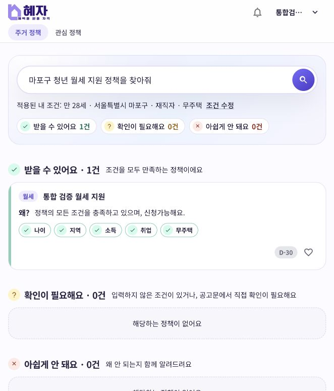
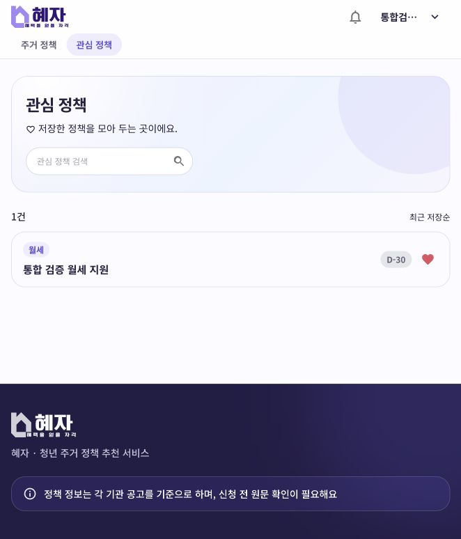
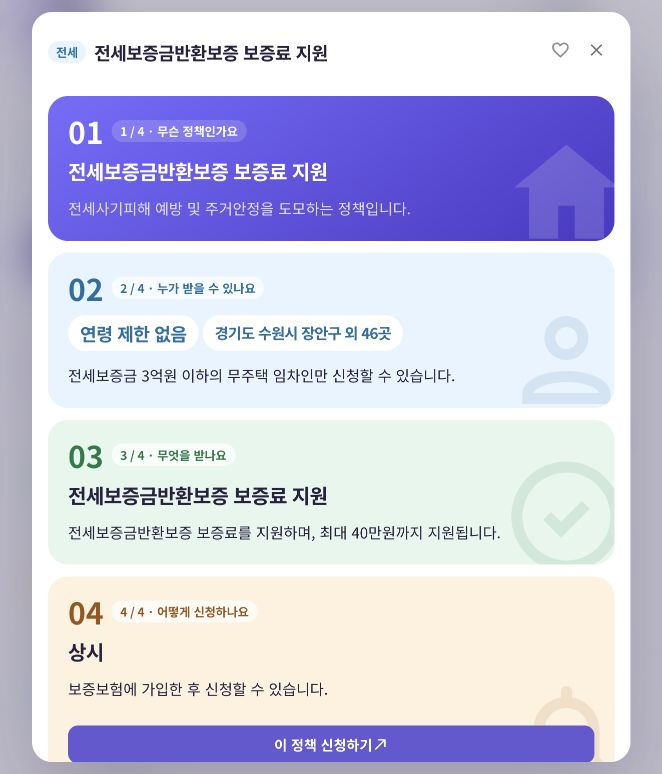

# Policy 주요 기능 최종 통합 검증 — Issue #119

> 실행일: 2026-11-04 (Asia/Seoul). 검증 브랜치: `test/119/policy-final-integration`.

## 1. 결과와 범위

검증 전용 로컬 환경에서 실제 Gateway·프런트·OpenAI·서비스 간 API·Kafka를 연결했다. **API 24항목, Kafka 5항목, 화면 9시나리오가 통과**했다. 운영 기능·판정 코드와 기본 설정은 변경하지 않았다.

- 백엔드 기준: `a37de901a3d4769f392af2cc9b7ca15b6c2afb98` (develop 최신화 후 분기).
- 프런트 기준: `958cb4cd7236b3d51b112d32a1e42cb5bb9849ad` (hyeja-frontend develop의 별도 검증용 복사본).
- 실제 구성: Java 17 JVM 6개(Eureka·Gateway·User·Policy·Recommendation·Engagement), MariaDB 13.0.2, Redis, Kafka 4.1.1, 실제 프런트 빌드 및 관리형 브라우저.
- Docker Desktop 실행 파일이 없어 Compose 대신 개별 프로세스로 실행했다. 배포 Compose의 Kafka 이미지(3.9.1)와 버전도 다르므로 Compose 검증으로 간주하지 않는다.
- Config Server·TLS·Cloud Bus·Zipkin·Prometheus 수집 서버·클라우드 배포는 검증 범위 밖이다. Engagement의 Prometheus 엔드포인트는 Kafka 처리 카운터 확인에 사용했다.

## 2. 데이터·인증과 실행 설정

- 서비스별 독립 DB 및 해당 DB에만 권한이 있는 계정을 생성했다. 기존 policy_db·user_db·engagement_db는 변경하지 않았다.
  - Policy: `v119_policy_f42f01`
  - User: `v119_user_f42f01`
  - Engagement: `v119_engagement_f42f01`
- 일반 회원·관리자는 테스트 DB에 비밀번호 해시와 프로필을 미리 넣었다. 실제 회원가입·이메일 인증·관리자 자동 생성은 검증하지 않았다.
- 로그인은 실제 `POST /api/members/login`을 Gateway 경유로 호출했다. JWT 검증, Redis 블랙리스트 조회와 Gateway→Engagement assertion 발급·검증은 실제 구현을 사용했다.
- JWT·assertion·모니터링·DB 비밀값은 검증용으로 분리했고 문서·Git에 포함하지 않았다. 외부 API 키는 Policy 로컬 .env에서 필요한 항목만 읽어 환경변수로 전달했다.
- Recommendation 검색 기본값은 여전히 `false`다. **검증 런타임에서만 `RECOMMENDATION_SEARCH_ENABLED=true`로 켰다.** 시연 환경에서도 담당자가 활성화 설정을 확인해야 한다.
- Gateway는 Config Server 필수 import가 있어, 원본 application.yml을 복사한 검증용 외부 설정에서 그 import만 제외했다. 라우팅·JWT·CORS 규칙은 유지했다. `--spring.config.location=file:<검증용 gateway-runtime.yml>`로 실행했으며 저장소 설정은 수정하지 않았다.
- 공통 런타임: Config client·Bus·Stream 비활성화, 서버 loopback 바인딩, Eureka URL 명시, JVM 힙 상한 384MB. Policy·User·Engagement는 실제 검증 Kafka 주소를 주입했다.
- Policy는 검증 프로필에서 테이블 생성 후 용어 시드와 지역 CSV를 적재하도록 런타임 설정했다. 서비스 간 호출은 직접 URL 대신 Eureka 서비스 이름을 사용했다.

## 3. 수집·검색 입력

- 기존 #73에서 확보한 실제 온통청년 1페이지 응답 중 아래 3건의 원문을 변경하지 않고 로컬 중계로 전달했다. 목록·페이지 수만 3건으로 제한했다. 이번 실행에서 공식 온통청년 서버를 다시 조회하거나 전체 수집을 반복하지 않았다.
  - `20261030005400214653`: 전세보증금반환보증 보증료 지원
  - `20261030005400214621`: 진안군 청년쉐어하우스 월랑 입주 지원
  - `20261030005400214612`: 진안군 청년 주거비 지원사업
- 관리자 JWT로 Gateway의 `/api/policies/sync`를 호출했다. **Policy AI는 실제 OpenAI를 호출**했고, 저장·카드뉴스 생성·Outbox·Relay·Kafka·스냅샷 반영 코드는 대체하지 않았다.
- 검색·관심 흐름을 안정적으로 확인할 목적으로, 테스트 DB에만 `VERIFY119-MONTHLY`(통합 검증 월세 지원) 정책을 추가했다. 전국·기간 내·자격 제한 없음으로 구성한 합성 데이터이며 실서비스 정책으로 간주하지 않는다.
- 일반 회원 프로필: 1998-01-01생, 마포구 11440, 재직·무주택. 검색어: `마포구 청년 월세 지원 정책을 찾아줘`.
- Recommendation AI도 대체하지 않았다. API 검증과 화면 검증에서 각각 자연어 검색을 실행했고, 의도 분석·개인화 이유 생성 실패 Fallback 경고는 관측되지 않았다. 통과가 AI 판단 전반의 정확성을 보장하지는 않는다.

## 4. API 검증 결과

| 항목 | 결과 |
|---|---|
| Real Gateway/User login ADMIN | PASS |
| Real Gateway/User login USER | PASS |
| Guest policy list through Gateway | PASS |
| Guest search requires login | PASS |
| Non-admin sync rejected | PASS |
| Admin collection with REAL OpenAI succeeds | PASS |
| Collection -> Outbox -> real Kafka -> 3 Engagement snapshots | PASS |
| Kafka processed event IDs persisted | PASS |
| Guest detail has no personalized judgement | PASS |
| Member detail loads F6 and five conditions | PASS |
| Favorite registration via Gateway and real F5 | PASS |
| F4 heart true after registration | PASS |
| Member policy list through Gateway | PASS |
| Favorite list contains registered policy | PASS |
| Duplicate registration preserves 409 | PASS |
| Natural-language search through Gateway with REAL OpenAI | PASS |
| Search returns controlled monthly policy | PASS |
| Search F3 returns registered heart | PASS |
| Favorite removal via Gateway | PASS |
| F4 heart false after removal | PASS |
| Gateway strips spoofed member headers | PASS |
| Invalid JWT rejected on public detail | PASS |
| Internal API unavailable without authentication | PASS |
| Internal API not externally routed even with JWT | PASS |

자연어 검색 API 응답은 200 / SUCCESS_001, 합성 월세 정책 1건이 approved에 포함됐고 F3 관심 표시가 true였다. API 1회 관측 시간은 약 4.984초다. 사용자 화면에서는 관심을 해제한 뒤 검색했으므로 미등록 하트로 표시됐다.

## 5. Kafka 검증 결과

| 항목 | 결과 |
|---|---|
| Duplicate Kafka event counted once and ignored | PASS |
| Malformed JSON delivered to DLT | PASS |
| Storage failure retries then reaches DLT | PASS |
| Failed event processing rolled back | PASS |
| Actual DLT topic contains malformed and failed messages | PASS |

- 수집 3건 → 정책 Outbox 3건 → Engagement 스냅샷 3건·처리 eventId 3건을 확인했다.
- 기존 eventId를 재전송해 duplicate 카운터 증가와 처리 이력 수 유지(3건)를 확인했다.
- 잘못된 JSON은 DLT로, 저장할 수 없는 긴 정책명을 넣은 별도 합성 이벤트는 재시도 후 DLT로 이동했다. 처리 실패 이벤트의 이력은 롤백됐다.
- 실제 `policy-updated-dlt` 토픽을 읽어 두 실패 메시지를 확인했다. 정상 정책 데이터를 훼손하거나 실제 운영 토픽으로 전송하지 않았다.

## 6. 실제 화면 검증

| 시나리오 | 결과 |
|---|---|
| 비로그인 홈에서 실제 Gateway 정책 목록 표시 | PASS |
| 비로그인 정책 상세와 로그인 안내 표시 | PASS |
| 실제 User/Gateway 로그인 후 회원 정보 표시 | PASS |
| 회원 상세에 조건 5가지와 판정 표시 | PASS |
| 상세 관심 저장 후 관심 해제 버튼·성공 안내 표시 | PASS |
| 관심 목록에서 등록 정책 1건 표시 | PASS |
| 관심 해제 후 빈 목록·해제 안내 표시 | PASS |
| 실제 AI 자연어 검색 결과와 3그룹 표시 | PASS |
| 실제 수집 정책의 카드뉴스 4장 표시 | PASS |

프런트는 `VITE_USE_MOCK=false`, `VITE_API_BASE_URL=http://localhost:8000`으로 빌드했다. 실제 브라우저에서 http://localhost:5173에 접속했고, 수동 API 응답 주입이나 UI 목 서버는 사용하지 않았다. Playwright의 Chrome 직접 실행이 SIGABRT로 종료돼 관리형 브라우저로 동일 흐름을 확인했다.

## 7. 빌드·검증 종료

- 최신 Policy: `test bootJar` 성공, 270개 테스트 실패·오류·건너뜀 0.
- 최신 Recommendation: `test bootJar` 성공, 24개 테스트 실패·오류·건너뜀 0.
- 최신 Gateway: `test bootJar` 성공, 16개 테스트 실패·오류·건너뜀 0.
- User·Engagement·Eureka는 #77/#112에서 빌드·검증한 JAR를 재사용했다. 5835870부터 이번 기준 커밋까지 해당 서비스의 코드·설정 변경이 없음을 git diff로 확인했다. 이번 작업에서 해당 자동 테스트는 재실행하지 않았다.
- 프런트 `npm ci` 및 실제 API 모드 `npm run build` 성공. 프런트 전체 단위/E2E 자동 테스트는 재실행하지 않았다. 현재 Node 24.11.1에서 일부 테스트 의존성의 엔진 버전 경고가 있었다.
- 실행기가 자신이 띄운 6개 JVM·Redis·Kafka·프런트 프로세스를 종료했다. 중계 서버를 포함해 사용한 11개 포트가 모두 닫힌 것을 확인했다. MariaDB 서버는 기존 사용자 프로세스이므로 종료하지 않았다.
- 검증용 DB와 실행 로그는 로컬 확인용으로 보존했다. 비밀값·임시 실행기·DB 원문은 Git에 포함하지 않았다.

## 8. 재현·시연 순서

1. 최신 서비스별 JAR와 프런트 빌드를 준비하고, 서비스별 독립 DB·검증 계정 및 지역/용어 초기 데이터를 준비한다.
2. Redis·Kafka·Eureka를 먼저 실행하고 필요한 토픽을 생성한다. 서비스별 DB·공통 JWT·Gateway assertion·Eureka·Kafka·AI 환경변수를 일치시킨다.
3. 테스트 범위에 따라 Config Server를 실제 준비하거나, 이번처럼 검증 전용 외부 설정으로 제외한다. 시연 환경에서는 Config/TLS를 포함한 별도 점검이 필요하다.
4. Recommendation 검색을 활성화하고, Gateway·User·Policy·Recommendation·Engagement를 실행해 등록·헬스를 확인한다.
5. 소량 검증 입력을 사용해 관리자로 수집 요청을 보내고 Outbox·스냅샷·처리 이력을 확인한다. 전체 수집은 이 검증의 필수 조건이 아니다.
6. 비로그인 홈·상세 → 로그인 → 상세 판정 → 관심 저장 → 관심 목록 → 관심 해제 → 자연어 검색 순으로 화면을 확인한다.
7. 필요하면 검증 토픽에 같은 eventId 및 실패 메시지를 넣어 중복 무시·재시도·DLT를 확인한다. 운영 토픽에는 테스트 메시지를 보내지 않는다.
8. 결과와 미검증 항목을 기록하고 직접 시작한 프로세스만 종료한다.

## 9. 알려진 제약 및 별도 작업

- #77의 구형 시·도 코드 판정 차이는 기존 로직·데이터 제약으로 유지했다. 이번에 수정하지 않았다.
- 전체 수집 실험에서 발견한 지역 코드 매핑·housing_type 길이 오류는 이번 이슈의 수정 범위 밖이다. 전체 403건 중 397건 저장·6건 실패한 별도 실험과 이번 소량 통합 검증을 구분한다.
- 실제 회원가입·메일 발송·관리자 초기 생성·운영 데이터 전체·동시 부하·Cloud Bus 공존·Config TLS·Compose/CD 배포는 미검증이다.
- 회원 자격 판정·F4·F6 및 다른 서비스 구현은 담당자의 기존 코드를 사용했다. 이번 작업에서 해당 기능을 신규 구현하거나 기존 정책 규칙을 수정하지 않았다.
- 이 결과는 명시한 로컬 통합 환경에서의 통과이며, 기본 설정 그대로 배포하면 모든 기능이 활성화된다는 의미는 아니다.
