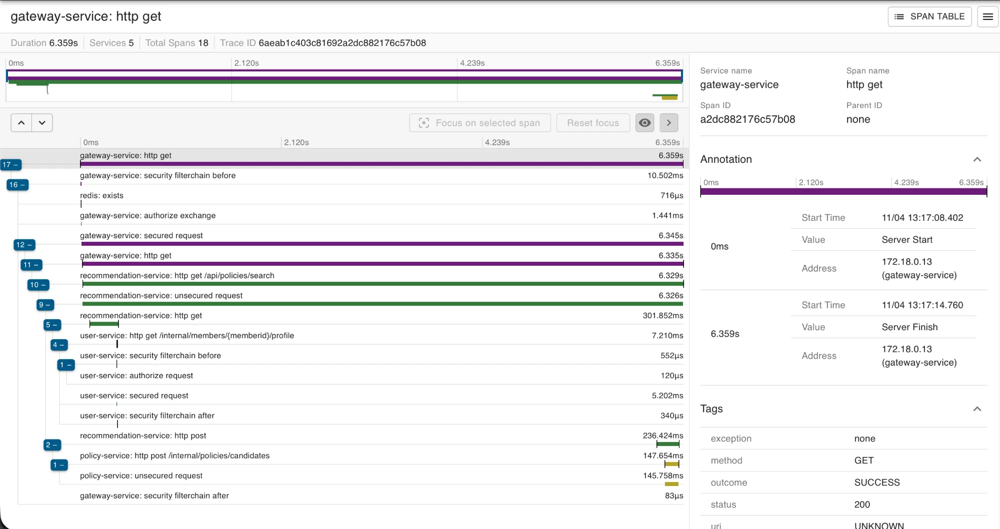

# User 실제 환경 기능 검증 — Issue #127

- 검증일: 2026-11-04 (Asia/Seoul)
- 작업 브랜치: `test/127/user-live-verification`
- 기준 커밋: `cec924f` — PR #124가 머지된 develop
- 실행 방법: CD가 올린 GHCR 이미지(`cec924f`)로 `scripts/deploy.sh` 실행 (Compose 서비스 13개)
- 관련 구현: 이메일 인증 #42, 회원 계정·JWT #50, 회원가입·프로필 #64, 내 조건 #69, 내부 F1·F6 #56, 탈퇴 #70, 탈퇴 이벤트 #85·#87, engagement 정리 #101·#110, 검색 활성화 #116
- 결과: 확인 항목 **21개 모두 통과**. 운영 코드 수정 없음.

## 1. 실행 범위

```text
curl → Gateway(:8000, JWT 검증·X-Member-Id 재설정)
  → user-service      회원가입·로그인·내 계정·내 조건·탈퇴
  → policy-service    → user-service /internal/members/{memberId}/profile  (F6)
  → recommendation    → user-service /internal/members/{memberId}/profile  (F1)
                      → policy-service /internal/policies/candidates       (F2)
user-service 탈퇴 → member_outbox → Relay → Kafka member-withdrawn → engagement 정리
```

| 항목 | 환경 |
|---|---|
| 실행 | Docker Compose, `DOCKER_DEFAULT_PLATFORM=linux/amd64 ./scripts/deploy.sh` (Apple Silicon Mac) |
| 이미지 | `ghcr.io/lgcns-am06-project2-team5/<service>:develop`, revision 라벨 `cec924f` |
| 상태 | 헬스체크가 있는 컨테이너 모두 healthy, `/_infra/health/{user,policy,engagement,recommendation}` 4개 PASS |
| 외부 노출 | 업무 서비스 4개는 포트 미공개, 요청 진입점은 Gateway 8000. 인프라 포트는 `127.0.0.1`에만 바인딩 |
| 메일 | 실제 SMTP로 팀원 본인 메일에 인증 코드 발송 |
| 검색 AI | 실제 OpenAI 호출 (`recommendation.search.enabled: true`) |
| 정책 데이터 | `policy_db.policy` 0건 (수집 미실행) |
| 추적 | Zipkin (`localhost:9411`) |

응답의 `createdAt`·`updatedAt`은 컨테이너 기준 UTC이며, 아래 표의 시각은 KST로 적었다.

## 2. 기능 검증 결과

| # | 상황 | 기대 결과 | 실제 결과 | P/F |
|---|---|---|---|---|
| 1 | 인증 메일 발송 `POST /api/members/email-verifications` | SUCCESS_001, 만료 시간 | `expiresInSeconds: 300`, 메일 수신 | P |
| 2 | 받은 코드로 확인 `POST .../confirmation` | `verified: true` | `verified: true` | P |
| 3 | 회원가입 `POST /api/members` (프로필 포함) | SUCCESS_001, memberId | `memberId: 3` (13:12) | P |
| 4 | 로그인 `POST /api/members/login` | accessToken 발급 | 발급 | P |
| 5 | 내 계정 `GET /api/members/me` | 가입 정보 | memberId·이메일·닉네임 일치 | P |
| 6 | 내 조건 `GET /api/members/me/profile` | 코드와 이름 변환 | `서울특별시 강남구`, `미취업자` | P |
| 7 | 내 조건 수정 시 필수값 누락 | COMMON_003, 필드별 메시지 | `birth`·`houselessYn` 필수 메시지 | P |
| 8 | 내 조건 전체 수정 `PATCH /api/members/me/profile` | 바꾼 값 반영, 나머지 유지 | `서울특별시 종로구`, `재직자`, 생년월일·무주택·미혼·월세 유지 | P |
| 9 | 수정 후 재조회 | 수정 값 저장 | PATCH 응답과 같음 | P |
| 10 | F6 `GET /api/policies/housing/me?onlyEligible=true` | SUCCESS_001 | 빈 목록 (정책 0건) | P |
| 11 | F6 `GET /api/policies/card-news` | SUCCESS_001 | 빈 목록 (정책 0건) | P |
| 12 | F1 `GET /api/policies/search?query=월세 지원` | SUCCESS_001 | 3그룹 모두 0건 (정책 0건) | P |

## 3. 내부 호출 확인 (Zipkin)

user-service의 `GET /internal/members/{memberId}/profile` span이 3건 모두 200으로 기록됐다.

| 시각 (KST) | 외부 요청 | 지나간 서비스 | 의미 |
|---|---|---|---|
| 13:16:56 | housing/me | gateway → policy → user | F6 |
| 13:17:04 | card-news | gateway → policy → user | F6 |
| 13:17:08 | search | gateway → recommendation → user, policy | F1 + F2 |

검색 trace `6aeab1c403c81692a2dc882176c57b08`: 전체 6.359s, user 내부 프로필 조회 7.210ms, policy 후보 조회 147.654ms.



## 4. 보안 확인

| # | 상황 | 기대 결과 | 실제 결과 | P/F |
|---|---|---|---|---|
| 13 | user-service 포트 직접 호출 `localhost:8081` | 연결 안 됨 | `000` | P |
| 14 | 토큰 없이 `X-Member-Id: 1` 위조 | 401 | `401` | P |
| 15 | 내 토큰 + `X-Member-Id: 999` 위조 | 위조 무시, 내 정보 | `memberId: 3` | P |
| 16 | Gateway로 `/internal/members/1/profile` | 404 (라우트 없음) | `404` | P |

## 5. 회원 탈퇴 → Kafka 이벤트

| # | 단계 | 기대 결과 | 실제 결과 | P/F |
|---|---|---|---|---|
| 17 | 탈퇴 `PATCH /api/members/me/delete` | SUCCESS_001 | 13:25:26 성공 | P |
| 18 | `member` 행 | `deleted_at` 기록 | 기록됨 (프로필 행 유지) | P |
| 19 | `member_outbox` → Relay | 행 생성 후 `published_at` 기록 | `member-withdrawn`, 0.43초 뒤 기록, 로그 `member-withdrawn 1건 전송` | P |
| 20 | engagement 소비 | 소비자 그룹 lag 0, 정리 로그 | `engagement-member-cleanup` lag 0, `회원 탈퇴 데이터 정리 완료 … memberId=3, favorites=0, notifications=0` (13:25:27) | P |
| 21 | 탈퇴 계정으로 로그인 | 거부, 탈퇴 여부 노출 안 함 | MEMBER_005 `이메일 또는 비밀번호가 올바르지 않아요.` | P |

탈퇴 요청부터 engagement 정리까지 약 0.9초 걸렸다.

## 6. 검증하지 않은 범위

- 정책 데이터가 0건이라 F6·F1 결과 내용과 F3(관심 표시)는 확인하지 않았다. 정책 수집·조회와 F2·F3는 #73·#77에서 검증했다.
- 탈퇴 회원에게 관심·알림 데이터가 없어 실제 삭제 건수는 0건이다. 중복 이벤트 멱등 처리(#110)는 이번에 다시 확인하지 않았다.
- 서비스 장애·서킷 브레이커, 프런트 화면, Kubernetes·클라우드 배포는 범위 밖이다.

## 7. 정리

검증용 회원은 탈퇴 처리로 남겼다. 비밀값과 인증 코드, 토큰은 기록하지 않았다.
