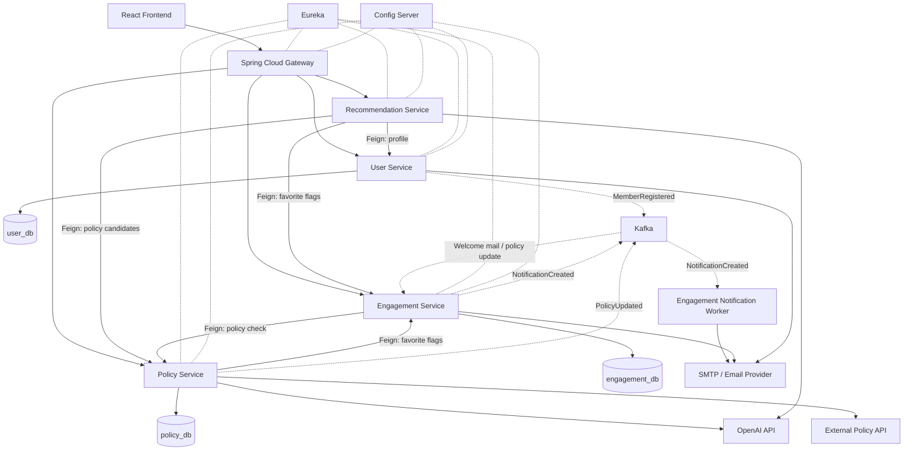

# HYEJA MSA 아키텍처 설계서

> 작성 기준: 2026-10-30 · 상태: **팀 논의용 목표 설계안(구현 확정/완료 아님)**  
> 기반: 기존 HYEJA 모놀리식 코드 분석(8개 도메인, 9개 테이블, 29개 API), 제공된 「기능/요구사항 명세서」(2026-10-30, 10쪽), MSA 전환 과제 요구사항, 팀 논의 내용.  
> 범위 주의: **웰컴 이메일**, **마감 알림 외부 이메일 발송**, **이벤트 전달용 보조 테이블**은 기존 요구사항/구현과 구별해야 하는 *추가·확장 제안*이다. 원래 기능을 변경하지 않는 것이 목표라면 팀 승인 후 착수한다.

## 1. 설계 목표와 원칙

- 기존 HYEJA의 회원/정책/관심/알림/추천 기능을 비즈니스 책임에 따라 **4개 마이크로서비스**로 분리한다.
- 외부에 노출되는 기존 29개 REST API의 **URL, HTTP 메서드, 인증 규칙, 요청·응답 DTO, 정렬·페이징, 오류 응답 및 Fallback**을 원칙적으로 유지한다. 신규 내부 API는 외부 계약과 구분한다.
- 각 서비스가 자신의 데이터를 독점 소유한다. **서비스 간 DB 직접 조회와 외래키는 금지**한다.
- 즉각적인 응답이 필요한 데이터 조회는 **OpenFeign(동기)**, 완료 사실의 전파와 독립 후속 작업은 **Kafka(비동기)**를 사용한다.
- **AI 기능이라는 기술적 이유만으로 별도 AI 서비스를 만들지 않는다.** 정책 관리/수집에 속한 AI는 Policy, 맞춤 검색·판정에 속한 AI는 Recommendation에 둔다.
- Spring Cloud Gateway를 단일 진입점으로 사용하고 Eureka, Config Server를 공통 인프라로 둔다.
- 기존 동작 보존과 새로운 이메일 기능 추가는 서로 다른 작업으로 관리한다.

## 2. 전체 시스템 구성

| 구분 | 컴포넌트 | 책임 |
|---|---|---|
| Client | React Frontend | 홈, 로그인, 회원가입, 내 조건, 검색, 카드뉴스, 관심 정책, 알림 UI |
| Entry | API Gateway | 단일 외부 API 진입점, 경로별 라우팅, 공통 필터 및 요청 추적 |
| Business | User Service | `member`, `profile`, 로그인/JWT, 이메일 인증 및 계정 관련 기능 |
| Business | Policy Service | `policy`, `region`, `term`, `cardnews`, 정책 조회·수집·카드뉴스 및 정책 관련 AI |
| Business | Engagement Service | `favorite`, `notification`, 관심 정책, 앱 내 알림, 신규 비동기 이메일 발송 |
| Business | Recommendation Service | 자연어·해시태그 검색, 맞춤 정책 추천, 자격 판정 및 추천 이유 AI 생성 |
| Infra | Eureka Server | 서비스 등록·발견 및 서비스 이름 기반 라우팅 지원 |
| Infra | Config Server | 서비스별 설정 중앙 관리(프로필별 환경 설정 포함) |
| Messaging | Kafka Broker | 회원가입·정책갱신·알림 생성 이벤트 전파 |
| Persistence | MariaDB | 서비스별 논리 DB와 계정 분리: `user_db`, `policy_db`, `engagement_db` |
| External | OpenAI API | 정책 분석/카드뉴스, 검색 의도·추천 설명 생성 |
| External | 정책 공공 API | 정책 원천 데이터 수집 |
| External | SMTP/Email Provider | 기존 인증 메일 및 추가 웰컴/마감 알림 메일 발송 |

### 개념적 서비스 구성도

> 그림의 이벤트·새 이메일 전송 경로는 **목표 아키텍처 제안**이며 실제 구현 여부는 기능 범위 승인 후 확정한다. Kafka 토픽은 Broker 안의 논리적 로그이고 Worker는 현재 권장안에서 **Engagement Service 내부 컴포넌트**이지 다섯 번째 마이크로서비스가 아니다.

## 3. 마이크로서비스별 비즈니스 책임과 기존 코드 이관

### 3.1 User Service

**소유 도메인:** `member`, `profile`  
**핵심 업무:** 회원가입, 이메일 로그인, JWT 인증, 회원 탈퇴, 프로필 및 추천용 사용자 조건 관리. 요구사항 문서에 명시된 이메일 찾기·비밀번호 재설정은 **현행 코드에 구현되어 있는지 확인 후** 이관 범위를 확정한다.

- 사용자가 입력하는 추천 조건 8종을 User가 관리: 필수 **생년월일, 거주지, 취업 상태, 무주택 여부** / 선택 **혼인 여부, 연소득, 학력, 주거 형태**.
- 프로필 저장과 기본 검증은 User 책임. 이 데이터로 어떤 정책이 적합한지 **판정**하는 책임은 Recommendation에 둔다.
- 기존 회원가입 인증 이메일은 User에서 유지한다. 추가 웰컴 이메일의 실제 발송 책임은 Engagement로 위임한다.
- 회원 탈퇴 시 Engagement의 관심 정책·알림 정리와 데이터 일관성에 관한 별도 설계 필요.

**DB:** `user_db` = `member`, `profile`  
**내부 제공 계약(예시):** 회원 프로필/자격조건 조회, 회원 존재 확인(서비스 내부용); 실제 경로 및 필드명은 계약 단계에서 결정.

### 3.2 Policy Service

**소유 도메인:** `policy`, `region`, `term`, `cardnews`  
**핵심 업무:** 전체 정책·상세 조회, 카테고리·지역 검색, 정렬·페이징, 외부 정책 데이터 수집·동기화, 지역 및 정책-지역 관계, 정책 용어, AI 카드뉴스.

- 홈 정책 목록: 카테고리(전체/월세/전세/청약·구입/공공임대/기타 주거), 마감일·조회수·가나다 정렬, 페이징.
- 카드뉴스: 정책 정보의 요약과 AI 기반 설명, 상세 조회. 카드뉴스 저장의 원본 소유권은 Policy.
- 추천 서비스가 사용할 정책 후보 **일괄 조회 API** 제공.
- 앱 전체 목록·카드뉴스에 필요한 관심 여부는 Engagement에서 배치 조회; 가능하면 N+1 네트워크 호출 회피.
- 정책 상태·마감일 변경 시 `PolicyUpdated` 이벤트 발행을 검토한다.

**DB:** `policy_db` = `policy`, `policy_region`, `region`, `term`, `card_news` (테이블 표기는 개념명으로 실제 DDL과 대조 필요).

### 3.3 Engagement Service

**소유 도메인:** `favorite`, `notification`  
**핵심 업무:** 관심 정책 등록·해제·조회, 사용자의 정책별 관심 여부, D-7 앱 내부 마감 알림의 생성·조회·읽음/삭제.

- 관심 여부 일괄 조회 API를 Policy 및 Recommendation에 제공.
- Policy의 원본 데이터를 참조하되 다른 DB의 엔티티/FK를 직접 참조하지 않는다.
- 관심 정책의 **키워드 필터링·정렬·페이징**은 기존 JOIN 결과와 동등해야 하므로 설계가 필요하다.
- D-7 알림 계산에 필요한 정책 상태는 정책 업데이트 이벤트 기반 **로컬 읽기 모델** 또는 검증용 동기 조회를 사용한다.
- **신규 제안:** `MemberRegistered` 소비 → 웰컴 이메일 요청. `NotificationCreated` 이벤트 기반 이메일 전송 Worker, 실패 재시도·전송 기록.

**DB:** `engagement_db` = `favorite`, `notification` (+ 승인 시 이벤트 처리 기록/Outbox/읽기 모델 보조 테이블).

### 3.4 Recommendation Service

**기존 코드 출처:** `policy` 패키지의 추천/검색/자격판정 관련 비즈니스 로직을 기능별로 추출.  
**핵심 업무:** 사용자 자연어 검색(최대 200자 등 기존 검증 규칙 확인), 해시태그 검색, 검색 의도 분석, 사용자 조건과 정책 지원조건의 비교, AI 추천 이유 생성, 결과 분류.

- 입력 데이터: User에서 조건 조회, Policy에서 후보 정책 조회, 필요하면 Engagement에서 관심 여부 일괄 조회.
- 추천 결과 세 분류: **받을 수 있어요 / 확인이 필요해요 / 아쉽게 안 돼요**.
- 자격 판정 규칙(Java 등)과 AI 설명 생성의 책임을 Recommendation에 둔다.
- AI 요청 실패 시 현행 검색·설명 Fallback, JSON 필드 및 검색 순서 보존.
- 기존 외부 `/api/recommendations` 경로는 명세서상 제안 경로일 수 있으므로 **실제 코드 API와 대조한 후** Gateway 경로와 매핑한다.

**DB:** 초기에는 없음. Recommendation은 다른 DB에 직접 연결하지 않는다. 향후 캐시/읽기 모델이 필요하면 독립 DB로 확장할 수 있으나 필수는 아니다.

## 4. Database per Service와 관계 전환

| 소유 서비스 | 논리 DB | 원본 테이블 | 핵심 내부 관계 |
|---|---|---|---|
| User | `user_db` | `member`, `profile` | profile → member FK 내부 유지 가능 |
| Policy | `policy_db` | `policy`, `policy_region`, `region`, `term`, `card_news` | policy_region → policy/region, card_news → policy 내부 FK 유지 가능 |
| Engagement | `engagement_db` | `favorite`, `notification` | 사용자/정책 참조는 값 기반 식별자 보관 |
| Recommendation | 없음 | 해당 없음 | 타 서비스 데이터는 API를 통해 조회 |

**서비스 간 FK 제거 대상:** `profile → region`, `favorite → member`, `favorite → policy`, `notification → member`, `notification → policy` 등. 각 참조는 원본 서비스가 소유한 안정적인 ID/코드 값으로 전환한다. ID 자료형은 실제 엔티티와 스키마 기준으로 확정한다.

**구축 방법:** 개발 단계에서는 MariaDB 인스턴스 하나에 3개 논리 DB를 두어도 된다. DB 계정을 분리하여 각 서비스는 자기 DB에만 권한을 갖도록 설정한다.

**강한 결합과 위험:**
1. 회원 탈퇴는 기존 단일 트랜잭션이 여러 서비스 DB에 분산됨. 동기 호출조차 전체 원자성을 자동 보장하지 않으므로 실패 정책/보상/상태 관리 검토.
2. 관심 정책 목록은 정책명과 내용 기반 JOIN 검색·페이징을 사용함. 단순 호출 후 필터링은 페이지 결과를 바꿀 수 있음.
3. 알림 대상 선정은 회원·정책·관심등록 상태를 함께 확인함. 이벤트 기반 동기화 시 지연과 오래된 정보에 유의.
4. 정책 카드와 추천 결과의 `isFavorite` 값은 실사용자 인증과 일치해야 하며, 배치 조회를 권장.

## 5. 동기 통신 — OpenFeign

| 호출자 → 제공자 | 필요한 데이터 | 트리거 | 권장사항 |
|---|---|---|---|
| Recommendation → User | 사용자 프로필 및 자격조건 | 맞춤 검색 요청 | 사용자 ID/인증 전파 기준 명시 |
| Recommendation → Policy | 정책 후보 목록 | 자연어·해시태그 검색 | 일괄 조회·페이징 계약·타임아웃 |
| Recommendation → Engagement | 관심 여부 목록 | 추천 응답 생성 | 정책 ID 여러 개 한 번에 조회 |
| Policy → Engagement | 관심 여부 목록 | 홈 목록/상세/카드뉴스 | 미로그인 요청과 잘못된 JWT의 기존 응답 구분 |
| Engagement → Policy | 정책 존재/상태 확인 | 관심 정책 등록 등 | 요청 내 양방향 순환 호출 금지 |

동기 호출의 장애 시 기존 HTTP 상태 코드/예외 우선순위가 변하지 않도록 테스트한다. OpenFeign은 **처리 결과를 즉시 알아야 하는 조회나 검증**에 사용한다.

## 6. 비동기 통신 — Kafka 및 이메일/알림 흐름

### 6.1 제안 이벤트 계약

| Topic(안) | Producer | Consumer | 발생 시점 | 목적 | 범위 |
|---|---|---|---|---|---|
| `member-registered` | User | Engagement | 회원가입 DB 커밋 이후 | 웰컴 이메일 발송 | **신규 기능** |
| `policy-updated` | Policy | Engagement | 정책 변경·동기화 완료 후 | 알림용 정책 상태 읽기 모델 갱신 | MSA 데이터 동기화 |
| `notification-created` | Engagement | Engagement 내부 Delivery Worker(별도 Consumer Group) | 앱 내부 알림 저장 완료 후 | 실제 외부 이메일 발송 | **신규 기능** |

이벤트 공통 권장 필드: `eventId`, `eventType`, `eventVersion`, `occurredAt`, `aggregateId`; 필요 시 마감일·정책 상태 등 최소 데이터. 개인정보와 인증 토큰은 불필요하게 넣지 않는다. Topic의 구체적 파티션/키/보관 정책은 추후 결정한다.

### 6.2 회원가입 → 웰컴 이메일(신규)

1. 클라이언트가 **동기 회원가입 API** 호출.
2. User Service가 회원/프로필을 기존 규칙대로 저장하고 원래 성공 응답을 반환.
3. 안전한 발행 메커니즘(권장: Transactional Outbox)을 통해 `MemberRegistered` 이벤트를 Kafka에 기록.
4. Engagement Consumer가 이벤트를 읽어 중복 여부와 전송 상태를 확인.
5. SMTP/Email Provider로 웰컴 메일 발송. 실패 시 재시도하고 필요 시 DLQ로 이동.
6. 외부 이메일 전송의 성공/실패는 **기존 회원가입의 성공/실패 결정에 개입하지 않음**.

> 시점에 주의: Outbox를 사용하면 이벤트 레코드가 가입 DB 트랜잭션에 함께 기록되고 별도의 Publisher가 나중에 Kafka로 전달한다. 회원가입 응답보다 Kafka 발행이 늦을 수도 있다.

### 6.3 D-7 알림 생성 → 실제 이메일 발송(신규 외부 전송)

1. Engagement Scheduler가 기존 로직과 동일하게 알림 대상 계산 및 `notification` 저장.
2. `NotificationCreated` 이벤트를 발행.
3. Engagement 내부 Worker가 메시지를 소비하여 이메일 발송 수행.
4. 전송 성공·실패 상태 관리; 실패 시 재시도하되 중복 발송 위험에 대비.
5. **기존 앱 내부 알림 목록·읽음·삭제 동작은 이메일 전송 장애와 무관하게 유지**.

### 6.4 정책 변경 → Engagement 데이터 동기화

1. Policy Service가 정책 원본 DB의 마감일·상태 등을 갱신.
2. `PolicyUpdated` 이벤트 발행.
3. Engagement가 이벤트를 소비하여 자체 읽기 모델 업데이트.
4. 이후 D-7 알림 선정에 활용. 동기화 지연 시 최신 정책 상태 재확인 전략 필요.

### 6.5 이벤트 안전성

- **Outbox:** DB 커밋과 이벤트 발행 간 누락 방지. Outbox DB 기록과 메시지 전송은 별도 단계임.
- **멱등성:** 같은 `eventId`가 재전달되어도 로컬 데이터가 중복 적용되지 않도록 함.
- **Retry + DLQ:** 일시 장애 재시도, 반복 실패 이벤트 격리 및 운영자 재처리 절차.
- **순서 관리:** 정책별 키를 정해 순서 보장 범위 설정; 이전 이벤트가 최신 데이터 덮어쓰지 않도록 버전 검증.
- **메일의 실질 중복:** Consumer의 이벤트 중복 방지와 SMTP 외부 발송의 정확히 한 번 전달은 별도 문제. 발송 기록 및 공급자 멱등성 기능을 검토.
- **관측:** Consumer lag, 발행·소비 실패, 이메일 재시도·DLQ 수, 서비스 호출 지연 모니터링.

## 7. 인프라와 보안

- **API Gateway:** 외부 단일 진입점. 기존 URL 유지 및 서비스 라우팅, 공통 로깅/Trace ID 등 도입. 인증을 Gateway에만 의존하지 않고 각 서비스가 필요한 권한을 검증하게 설계.
- **Eureka:** Gateway와 모든 비즈니스 서비스 등록. 고정 포트 의존 대신 서비스 이름 기반 라우팅/조회.
- **Config Server:** 앱 이름·프로필(local/dev/prod)별 설정. 민감정보는 Git에 평문 커밋하지 않고 Secret/환경변수 등으로 보호.
- **Kafka:** 개발 환경 Docker Compose로 구동; Topic 구성, Consumer Group, 재시도 정책 명문화.
- **Docker:** 각 Spring Boot 애플리케이션별 Dockerfile, 전체 컴포넌트 Docker Compose; 향후 Kubernetes 배포 매니페스트.
- **외부 이메일:** 기존 가입 인증 이메일은 User 책임, 신규 웰컴/마감 이메일은 Engagement 책임. 이메일 발송 라이브러리 중복은 공통 클라이언트 수준에서만 관리 가능하며 도메인 로직을 공유 라이브러리로 묶지 않는다.

## 8. API 호환성·회귀 테스트 체크리스트

- [ ] 기존 29개 API를 Gateway를 통해 동일 경로/메서드로 접근할 수 있다.
- [ ] 로그인/로그아웃/JWT 발급·만료/401/403 동작이 동일하다.
- [ ] 비로그인 허용 API와 **잘못된 JWT를 전달한 경우**의 기존 차이를 유지한다.
- [ ] 회원가입/프로필 저장/검증 순서 및 오류 응답이 동일하다.
- [ ] 정책 목록 카테고리/정렬/페이징/상세 데이터가 동일하다.
- [ ] 카드뉴스 텍스트·페이지·좋아요 상태가 동일하다.
- [ ] 추천 결과 3가지 분류, 이유 문구, 검색·자격 판정 및 AI Fallback이 동일하다.
- [ ] 관심 정책 검색 결과의 정렬·페이징/중복 등록/하트 값이 동일하다.
- [ ] Asia/Seoul 기준 D-DAY, D-7 알림 대상 및 읽음·삭제 동작이 동일하다.
- [ ] 회원 탈퇴 시 User와 Engagement에 남는 데이터와 API 결과가 기존과 동일하도록 검증한다.
- [ ] 원래 DTO의 snake_case/camelCase 혼합·상태 코드·검증/예외 우선순위를 유지한다.
- [ ] Kafka 중복·지연·소비자 재시작·DLQ 재처리 테스트를 통과한다.
- [ ] 신규 웰컴/알림 이메일 기능은 별도 승인·테스트 항목으로 기록한다.

## 9. 권장 개발 단계

| 순서 | 작업 | 주요 산출물 |
|---|---|---|
| 1 | 기존 모놀리식 API/DB/주요 응답 기준선 확보 | API 계약표, DB 스냅샷, 회귀 테스트 |
| 2 | 서비스 경계와 DB 소유권 확정 | 서비스 책임표, 서비스별 ERD, 통신 계약 |
| 3 | Eureka·Config Server·Gateway 구축 | 서비스 등록·라우팅 동작 확인 |
| 4 | User·Policy·Engagement 분리 및 Repository 관계 수정 | 독립 빌드/DB/기존 CRUD |
| 5 | Recommendation 추출 및 OpenFeign 연동 | 프로필·정책 일괄 조회/추천 응답 |
| 6 | PolicyUpdated 기반 Kafka 이벤트 동기화 | Producer/Consumer/일관성 테스트 |
| 7 | 팀 승인 시 웰컴/마감 알림 이메일 추가 | 이벤트 전송, 상태 기록, Retry/DLQ |
| 8 | Docker Compose 통합, 테스트, 시연 | 통합 실행 가이드, 테스트 결과, 데모 영상 |

## 10. 팀 회의 결정 필요 항목

| 의사결정 | 기본 제안 | 결정 상태 |
|---|---|---|
| 마이크로서비스 수 | User / Policy / Engagement / Recommendation (4개) | 논의안 |
| AI 배치 | 정책 분석·카드뉴스→Policy, 검색·자격 판정→Recommendation | 논의안 |
| DB | user_db / policy_db / engagement_db, Recommendation 무상태 | 논의안 |
| 회원 탈퇴 | 기존 즉시 처리 의미 우선; 삭제 이벤트만으로 대체하지 않음 | 미결 |
| 관심 정책 검색 | 정확한 기존 필터/정렬/페이징 보존 가능한 읽기 모델 또는 배치 조회 | 미결 |
| 비동기 이벤트 | PolicyUpdated 우선 구현 | 논의안 |
| 웰컴 이메일 | 신규 기능 승인 후 MemberRegistered 이벤트 기반 | 승인 필요 |
| 마감 알림 외부 이메일 | 신규 기능 승인 후 NotificationCreated 기반 | 승인 필요 |
| 추천 API | 기존 외부 API 경로 우선 보존, 신규 내부 경로 분리 | 논의안 |
| 보안/배포 | Eureka, Gateway, Config, Compose; JWT/Secret/내부 API 보호 | 상세 협의 |

## 11. 근거 및 출처 구분

### 업로드된 기능/요구사항 명세서(2026-10-30)
- **3쪽 홈화면:** AI 검색 문장 및 해시태그, 카드뉴스, 정책 목록/카테고리/정렬/페이징, 하트, 알림 헤더.
- **4쪽:** AI 카드뉴스 상세, 정책 상세 및 하트 버튼.
- **6–7쪽:** 로그인, 이메일 찾기, 비밀번호 재발급/리셋, 회원가입·가입 후 JWT 발급·조건 등록 화면 이동.
- **9쪽:** 필수 조건 4개(생년월일/거주지/취업상태/무주택 여부), 선택 조건 4개(혼인/연소득/학력/주거 형태), 저장 검증.
- **10쪽:** 자연어 검색, 명세서에 기재된 `/api/recommendations` 예시, 추천 3분류.

### 기존 코드 분석 및 팀 설계 판단
- 8개 기존 도메인/9개 기존 테이블/29개 기존 API 수와 기존 교차 JOIN·트랜잭션·Fallback의 구체적인 위험은 사전 코드 분석에 기반한다.
- **4개 서비스의 경계**, **3개 DB**, **OpenFeign 호출 경로**, **Kafka 토픽**, **웰컴 이메일**, **외부 이메일 알림**, **Outbox/Retry/DLQ**는 원문 명세서에 완성된 구현으로 제시된 것이 아니라 이번 MSA 전환을 위한 제안이다.
- 명세서의 예정/미정 API 및 데이터 항목이 기존 코드와 다를 경우, **실제 구현·검증된 외부 계약**을 우선 기준선으로 삼고 차이를 별도 의사결정으로 기록한다.
