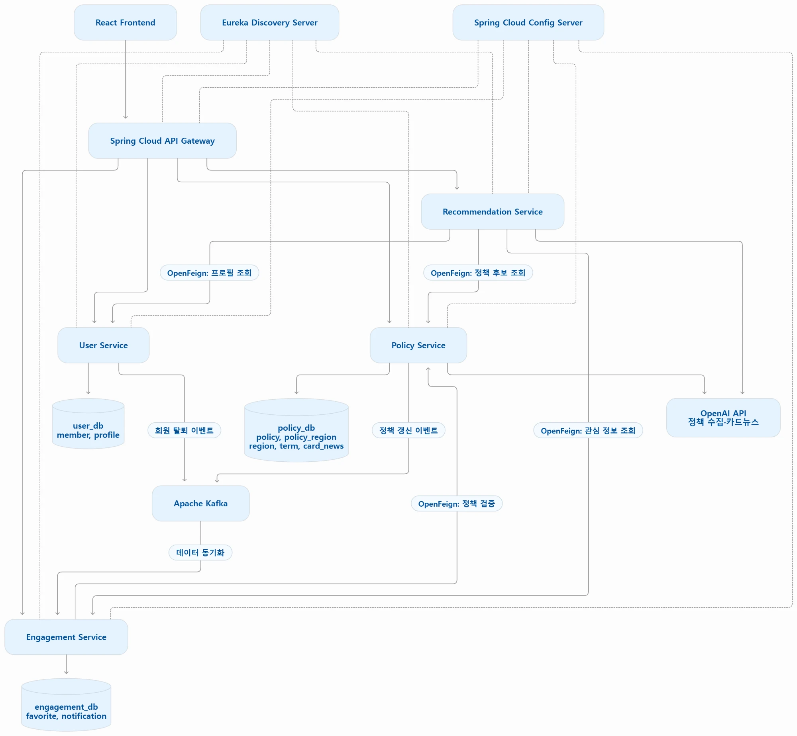

# 아키텍처

| 문서 | 내용 |
|---|---|
| [HYEJA_MSA_Architecture_Design.md](HYEJA_MSA_Architecture_Design.md) | 팀 MSA 설계서 (서비스 4개, DB 3개, Feign·Kafka, 위험과 결정 항목) |
| [설계_코드_대조.md](설계_코드_대조.md) | 설계서와 실제 코드 대조 결과, 빠진 호출, 결정 필요 항목 |
| [system-diagram.webp](system-diagram.webp) | 시스템 구성도 (Gateway, 서비스, Kafka 토픽, DB, 외부 API, 메일) |
| [service-diagram.webp](service-diagram.webp) | 서비스 구성도 (서비스 간 Feign·Kafka 흐름과 서비스별 DB) |

산출물로 낼 그림 3종: 서비스 구성도, 시스템 구성도(동기/비동기 구분, DB 포함), 배포 구성도(Docker Compose 또는 K8s 확정 후 추가)

## 시스템 구성도

## 서비스 구성도

