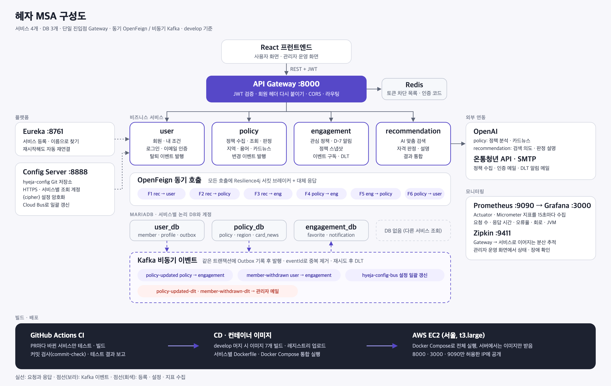
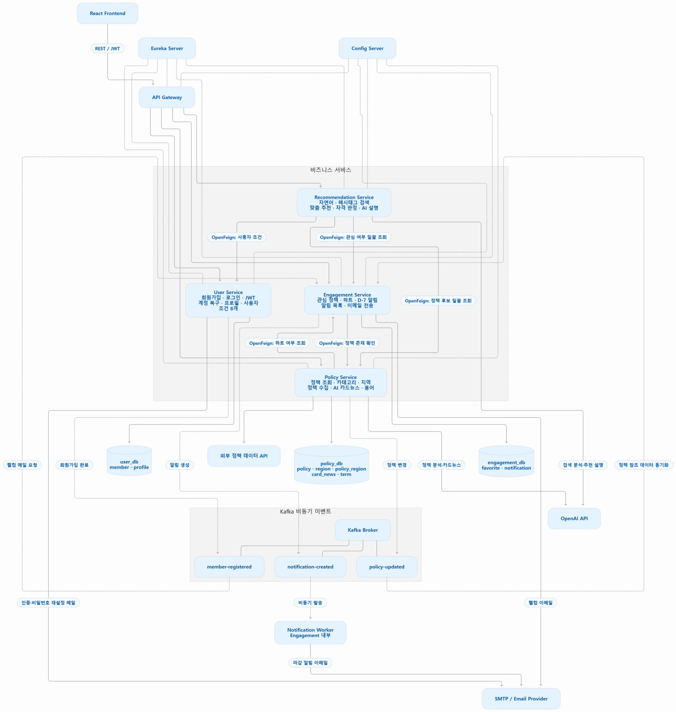
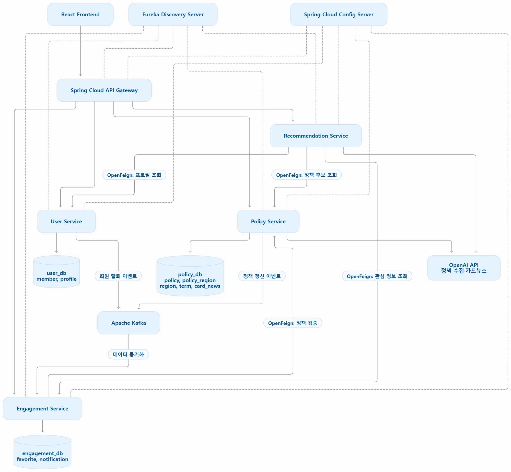

# 아키텍처

| 문서 | 내용 |
|---|---|
| [HYEJA_MSA_Architecture_Design.md](HYEJA_MSA_Architecture_Design.md) | 팀 MSA 설계서 (서비스 4개, DB 3개, Feign·Kafka, 위험과 결정 항목) |
| [설계_코드_대조.md](설계_코드_대조.md) | 설계서와 실제 코드 대조 결과, 빠진 호출, 팀 결정(#1) |
| [msa-architecture.png](msa-architecture.png) | 실제 코드 기준 구성도 (Gateway, 서비스 4개, DB 3개, Feign F1~F6, Kafka 토픽·DLT, 모니터링, CI/CD·EC2). 루트 README에 씀 |
| [system-diagram.webp](system-diagram.webp) | 설계 단계 시스템 구성도 (Gateway, 서비스, Kafka 토픽, DB, 외부 API, 메일). `member-registered`·`notification-created`·Notification Worker는 설계에만 있고 구현하지 않았습니다 |
| [service-diagram.webp](service-diagram.webp) | 서비스 구성도 (서비스 간 Feign·Kafka 흐름과 서비스별 DB) |

산출물로 낼 그림 3종: 서비스 구성도, 시스템 구성도(동기/비동기 구분, DB 포함), 배포 구성도. 배포는 EC2 한 대에 Docker Compose로 확정했고(K8s는 하지 않음), 그림은 아직 없습니다. 들어갈 내용은 [06 결과보고서](../06_결과보고서/README.md)에 적어 두었습니다.

## 실제 구성도

## 설계 단계 시스템 구성도

## 서비스 구성도

